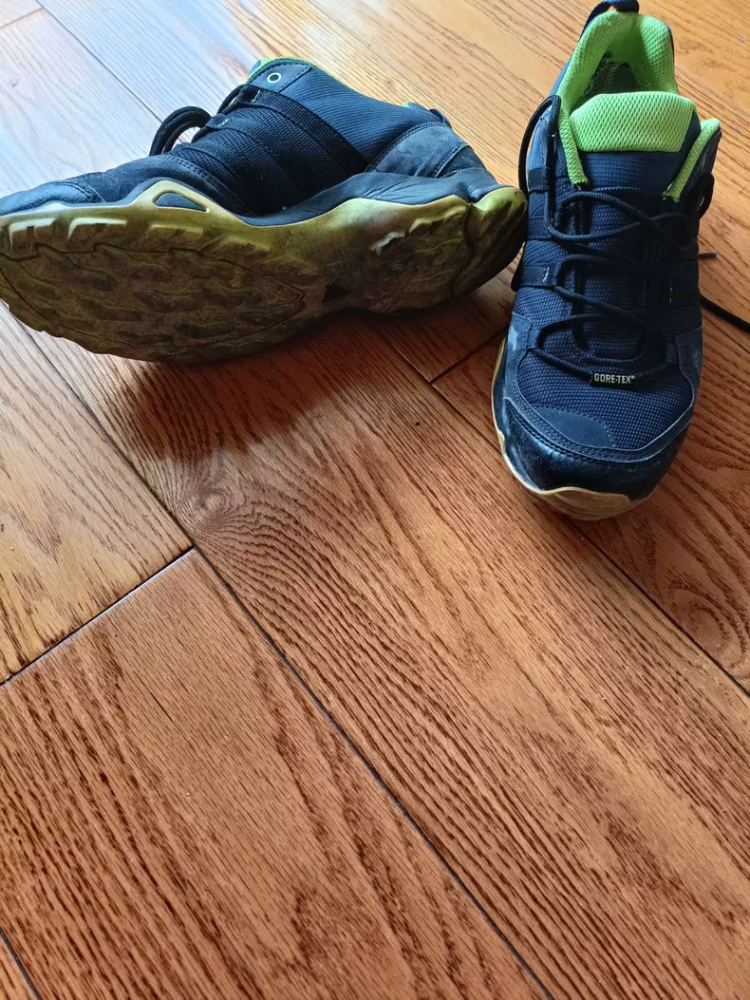
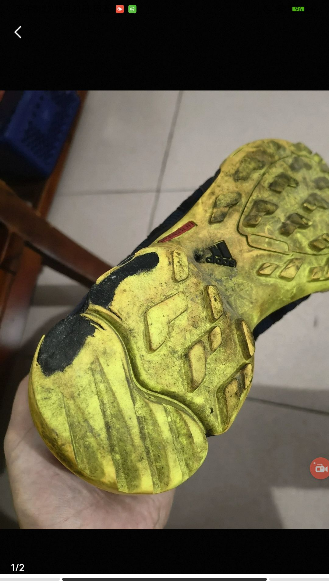
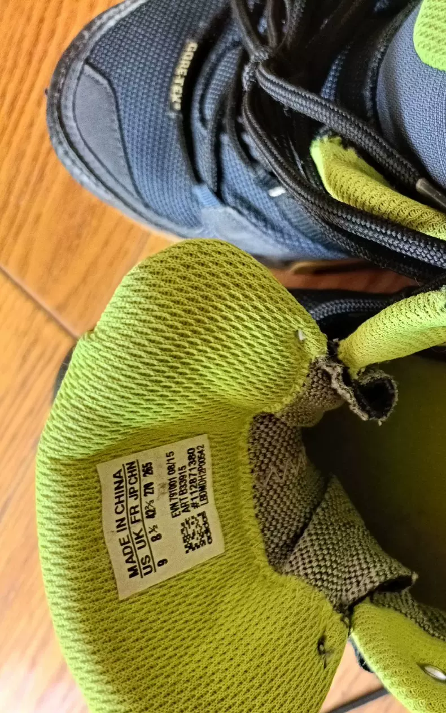
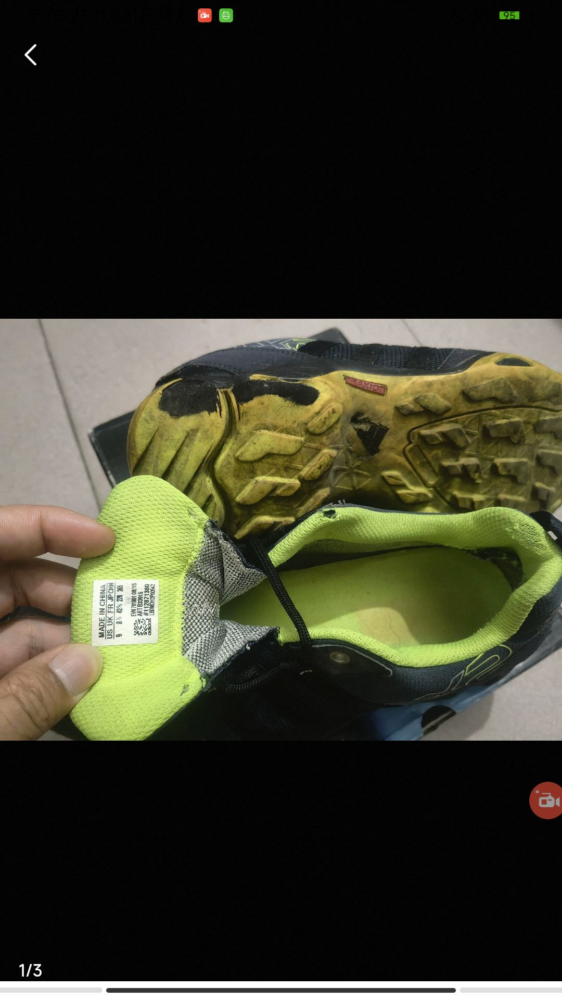

# Case 2401: weighing evidence across rounds in a sole-wear dispute

English | [简体中文](README.zh-CN.md)

**Final prediction: seller; reference outcome: buyer.** In this dispute over secondhand running shoes, differences between sole photographs were interpreted as item swapping by the buyer. Although three jurors shifted to the buyer in the third round, the model still supported the seller.

**Original human votes: 15 for the buyer and 2 for the seller.** The six system jurors’ opinions across three rounds are presented separately below.

## 1. Case facts and disputed issues

The item was a pair of secondhand Adidas running shoes priced at CNY 58 and listed as size 43. The listing stated “secondhand item” and “obvious signs of wear.” The buyer reported undisclosed defects; the seller alleged item swapping based on differences between sole photographs; the buyer then supplied tongue-label photographs to address the dispute over the item’s identity.

| Stage / source | Claim and evidence | Disputed issue |
| --- | --- | --- |
| Listing / seller | Secondhand running shoes for CNY 58; obvious signs of wear acknowledged, with photographs of the actual item. | Was the extent of wear on the received shoes fully disclosed? |
| Round 1 / buyer | Requested a refund, stating that the defects had not been disclosed at all, and submitted sole photographs. | Did the actual wear exceed what the listing showed? |
| Round 2 / seller | Refused the refund and alleged item swapping based on differences in tread, base color, and markings. | Do the photographs show the same shoe and the same area? |
| Round 3 / buyer | Requested intervention, asking “Could the tongue label be fake?”, and supplied labels and other photographs. | Do the labels match the listing and help establish the item’s identity? |

### Sole photographs

*Figure 1: The listing shows one sole at an angle; the other sole is not shown.*

*Figure 2: The buyer’s sole photograph shows substantial wear and black areas.*

The photographs differ in angle and coverage. The same shoe and area need to be identified before comparing tread and color.

### Tongue labels

*Figure 3: The tongue label originally shown in the listing.*

*Figure 4: The buyer’s additional label photograph from round 3 matches several legible size, article-number, and code details in Figure 3.*

These labels provide new information for checking the item’s identity and assessing the item-swapping allegation.

## 2. Social relationships among the jurors

Each juror follows two other jurors. In the figure, **B → A means that A follows B and can read B’s opinions from earlier rounds**. Each node lists the juror’s positions in rounds 1, 2, and 3.

[Chinese figure](images/social_network.png)

**Agent_2’s two shifts:** It was the only juror supporting the buyer in round 1. Its followed jurors, Agent_0 and Agent_3, both supported the seller. After the seller’s new comparison evidence arrived in round 2, Agent_2 also supported the seller, stating that “The chain of evidence indicates that the item was not sent by the seller.” After receiving the labels and other new evidence in round 3, it returned to the buyer: buyer → seller → buyer.

**Disagreement in round 3:** Agent_1 and Agent_4 also shifted to the buyer. All the jurors they followed had supported the seller in the previous round, showing that following a juror does not mean following that juror’s vote. Agent_0, Agent_3, and Agent_5 supported the seller throughout. The buyer:seller counts changed from 1:5 to 0:6 and finally 3:3.

## 3. GNNExplainer: spatial and temporal explanations

GNNExplainer traces the messages retained in the explanation of the current seller verdict through spatial and temporal connections. Spatial connections aggregate case summaries and juror opinions, while temporal connections transmit representations from earlier rounds. The analysis first presents the original content associated with these messages, then masks different message groups separately to examine how they relate to changes in the verdict.

### Spatial dimension: within-round information aggregation

**The selected spatial messages comprise case summaries and juror opinions.** Of the 27 messages, 18 carry case summaries to jurors across the three rounds. The remaining 9 are between jurors, and every source juror supports the seller in the corresponding round. Their reasons fall into two main categories: treating wear as a normal, disclosed condition of a secondhand item, and interpreting photographic differences as evidence of item swapping. The two groups of spatial messages are masked separately below to examine their roles.

The table lists key spatial connections identified by GNNExplainer. Arrows show information flow in the model; mask values indicate how much each message is retained in the explanation.

| Spatial message | Mask value | Source opinion or case summary |
| --- | --- | --- |
| Round 1: Agent_5 → Agent_4 | 0.9982 | [Supports the seller](#opinion-1-5): “if the initial description was truthful or the images already showed this condition” |
| Round 2: Agent_3 → Agent_2 | 0.9982 | [Supports the seller](#opinion-2-3): “This strongly suggests ‘item swapping’” |
| Round 3: Agent_3 → Agent_2 | 0.9981 | [Supports the seller](#opinion-3-3): “strongly suggesting item swapping or use by the buyer” |
| Round 3: Agent_5 → Agent_4 | 0.9977 | [Supports the seller](#opinion-3-5): “The item's condition has fundamentally changed, far beyond normal secondhand wear” |
| Round 3: Case → Agent_3 | 0.9962 | Case issue: “Whether the item was not as described and whether item swapping occurred.” |

**The upstream opinions still contain flaws in evidence correspondence and inference, and the final aggregation does not correct the erroneous prediction.** In round 3, [Agent_3](#opinion-3-3) interprets differences between sole photographs as “strongly suggesting item swapping or use by the buyer,” while [Agent_5](#opinion-3-5) treats the comparisons from the first two rounds as confirmation and concludes that the item's condition has fundamentally changed. The comparisons have not established whether the photographs show the same shoe and the same area, leaving an inferential gap between visual differences and the item-swapping judgment.

These opinions also enter nodes that have switched to the buyer. Although [Agent_2](#opinion-3-2) and [Agent_4](#opinion-3-4) support the buyer in their original round 3 opinions, the GNNExplainer-selected connections Agent_3 → Agent_2 (0.9981) and Agent_5 → Agent_4 (0.9977) still incorporate the seller-supporting reasons above into their node representations. Agent_5 → Agent_0 (0.9977) is also selected in the same round. The representations used for the verdict therefore contain both buyer-supporting views and these seller-supporting inferences. These source opinions participate in node aggregation, and the model ultimately still returns a seller verdict, inconsistent with the reference outcome.

**An even number of jurors allows a tie; this case has no final-round majority to follow directly.** The six jurors split 3∶3 in the third round, leaving neither side with a numerical advantage. Simply reading the final-round majority stance therefore cannot determine the verdict in this case. The model forms a final representation by aggregating case information, juror reasons, and information across rounds before classification; this goes beyond simply counting the jurors supporting each side.

### Temporal dimension: information transfer across rounds

Temporal messages carry a node's representations from earlier to later rounds, including information already aggregated spatially. **A temporal mask indicates how much of an existing message the explainer retains**: a value closer to 1 means that more of the message is retained.

**The 5 connections with the highest temporal masks.** All active cross-round connections are ranked together by their mask values, with each connection identified by its layer and attention head. Values are shown to six decimal places to distinguish close scores.

| Rank | Temporal message | Mask value (layer/head) | Original opinions in the two rounds |
| --- | --- | --- | --- |
| 1 | Agent_1: round 1 → 3 | 0.999037 (L1/H1) | [Supports the seller](#opinion-1-1) → [Supports the buyer](#opinion-3-1): shifts from judging the signs of use as normal for a secondhand item to finding a fundamental reversal in the item's characteristics. |
| 2 | Agent_5: round 1 → 2 | 0.998393 (L1/H0) | [Supports the seller](#opinion-1-5) → [Supports the seller](#opinion-2-5): shifts from a conditional judgment that wear was disclosed to using photographic differences to support the allegation of item swapping. |
| 3 | Agent_2: round 1 → 3 | 0.998274 (L1/H1) | [Supports the buyer](#opinion-1-2) → [Supports the buyer](#opinion-3-2): both opinions focus on whether the wear exceeds the description and whether the seller provided adequate disclosure. |
| 4 | Agent_4: round 1 → 3 | 0.998267 (L1/H1) | [Supports the seller](#opinion-1-4) → [Supports the buyer](#opinion-3-4): shifts from treating moderate wear as normal to finding serious nonconformity with the description. |
| 5 | Agent_3: round 1 → 3 | 0.998236 (L1/H1) | [Supports the seller](#opinion-1-3) → [Supports the seller](#opinion-3-3): shifts from judging the wear as normal for a secondhand item to suspecting item swapping or use by the buyer. |

The highest mask is **Agent_1's round 1 → 3 connection (0.999037)**, whose original stances change from seller to buyer. The highest-ranked connections cover seller → buyer, buyer → buyer, and seller → seller trajectories, showing that the explanation retains cross-round information from different patterns of stance evolution.

**The 3 jurors who switch from seller to buyer in round 3 also have high temporal masks.** The table below shows the maximum mask across layers and heads for each juror's round 2 → 3 connection.

| Temporal message | Mask value (layer/head) | Corresponding opinions |
| --- | --- | --- |
| Agent_2: round 2 → 3 | 0.998115 (L1/H1) | [Supports the seller](#opinion-2-2) → [Supports the buyer](#opinion-3-2): “The chain of evidence indicates that the item was not sent by the seller” → “the central issue is whether the item's condition is seriously nonconforming” |
| Agent_4: round 2 → 3 | 0.998107 (L1/H1) | [Supports the seller](#opinion-2-4) → [Supports the buyer](#opinion-3-4): “item swapping cannot be ruled out” → “the refund criterion of ‘serious nonconformity with the description’ is met” |
| Agent_1: round 2 → 3 | 0.998099 (L2/H1) | [Supports the seller](#opinion-2-1) → [Supports the buyer](#opinion-3-1): “making item swapping highly likely” → “The characteristics have fundamentally reversed” |

**The key is which historical information these high masks retain.** Agent_1, Agent_2, and Agent_4 switch to the buyer in round 3, but the round 2 → 3 routes above bring in historical representations from round 2. All three supported the seller in that round, citing, respectively, “making item swapping highly likely,” “The chain of evidence indicates that the item was not sent by the seller,” and “item swapping cannot be ruled out.” Thus, even as their third-round stances shift toward the buyer, the existing dispute over item identity continues to participate in the final-round computation through temporal connections.

**Spatial and temporal connections show how information from different sources comes together.** In round 3, Agent_2 and Agent_4's buyer-supporting opinions are aggregated together with their neighbors' seller-supporting reasons, case summaries, and historical representations. Assessing which message type the verdict is more sensitive to requires separate comparisons of case-summary messages, juror messages, and temporal messages.

**Group-wise masking further identifies the spatial route from case summaries.** Forward-pass comparisons use the same model, inputs, and learned masks. The spatial set contains the 27 messages described above, while the temporal set contains 43 selected cross-round messages counted by layer and head. When one group is masked, all other messages remain enabled. The margin in the table is the seller logit minus the buyer logit: a positive value yields a seller verdict, and a negative value yields a buyer verdict.

| Message intervention | Seller − buyer margin | Model verdict |
| --- | --- | --- |
| Original input | +3.1703 | Supports the seller |
| Retain only the selected spatial and temporal messages | +4.9187 | Supports the seller |
| Mask only the selected 27 spatial messages; leave temporal messages unchanged | −5.5237 | Supports the buyer |
| Mask only the selected 9 juror → juror messages | +3.1821 | Supports the seller |
| Mask only the selected 18 case-summary → juror messages | −4.5737 | Supports the buyer |
| Mask only the selected cross-round temporal messages; leave spatial messages unchanged | +2.4854 | Supports the seller |
| Mask all cross-round temporal messages; leave spatial messages unchanged | +2.1169 | Supports the seller |
| Mask the selected spatial and temporal messages together | −5.3918 | Supports the buyer |

**In these group-wise comparisons, verdict reversal is more directly associated with removing spatial messages from case summaries.** Masking only the 18 case-summary → juror messages changes the margin from +3.1703 to −4.5737, whereas masking only the 9 messages between jurors leaves the margin at +3.1821. This further locates a key part of the explanation for the current seller verdict in the spatial route through which case summaries enter juror nodes, rather than relying solely on the number of edges whose source jurors support the seller.

**Temporal messages affect the output margin, but masking them alone does not change the predicted class.** Masking all cross-round temporal messages reduces the margin to +2.1169, still yielding a seller verdict. This case therefore should not be reduced to “historical errors overpowering new evidence.” These comparisons identify effects at the level of message groups. The 18 case-summary messages span three rounds, and their specific rounds and summary content can be examined separately in further comparisons.

**Directions for improvement:**

- **Strengthen upstream fact checking and review of inferences.** Distinguish evidence from the listing, before shipment, and after receipt; align photographs of the same shoe and area, and compare the fields on the tongue labels. When generating reasons, distinguish observable facts, conditional judgments, and speculation about item swapping, so that wear visible after receipt is not treated directly as evidence of adequate presale disclosure.
- **Further examine evidence coverage and factual correspondence in case summaries.** Use comparisons by round to analyze their role in the final aggregation.
- **Validate improvements through comparisons by round and message type.** Holding other inputs fixed, separately revise each round's summary and adjust case-summary and juror messages, then compare verdict margins and the consistency of reasons with the evidence. For Agent_1, Agent_2, and Agent_4's switches to the buyer in round 3, focus on checking their new reasons, then test across more cases which stages and information adjustments can improve verdicts.

## 4. Full juror verdicts and reasons across three rounds

<table id="juror-opinions" style="display: table; table-layout: fixed; width: 100%; min-width: 1100px; border-collapse: collapse;">
<colgroup><col style="width: 76px;"><col span="6"></colgroup>
<thead><tr>
<th scope="col" valign="top" style="vertical-align: top; text-align: left; padding: 10px; overflow-wrap: anywhere; line-height: 1.55;">Round</th>
<th scope="col" valign="top" style="vertical-align: top; text-align: left; padding: 10px; overflow-wrap: anywhere; line-height: 1.55;">Agent_0</th>
<th scope="col" valign="top" style="vertical-align: top; text-align: left; padding: 10px; overflow-wrap: anywhere; line-height: 1.55;">Agent_1</th>
<th scope="col" valign="top" style="vertical-align: top; text-align: left; padding: 10px; overflow-wrap: anywhere; line-height: 1.55;">Agent_2</th>
<th scope="col" valign="top" style="vertical-align: top; text-align: left; padding: 10px; overflow-wrap: anywhere; line-height: 1.55;">Agent_3</th>
<th scope="col" valign="top" style="vertical-align: top; text-align: left; padding: 10px; overflow-wrap: anywhere; line-height: 1.55;">Agent_4</th>
<th scope="col" valign="top" style="vertical-align: top; text-align: left; padding: 10px; overflow-wrap: anywhere; line-height: 1.55;">Agent_5</th>
</tr></thead>
<tbody>
<tr data-stage="1" valign="top">
<th scope="row" valign="top" style="vertical-align: top; text-align: left; padding: 10px; overflow-wrap: anywhere; line-height: 1.55; white-space: nowrap;">Round 1</th>
<td data-agent="0" id="opinion-1-0" valign="top" style="vertical-align: top; text-align: left; padding: 10px; overflow-wrap: anywhere; line-height: 1.55;"><!-- opinion:start stage=1 agent=0 -->Conclusion: Support the seller Reason: The buyer's claim that the defects were not disclosed is seriously inconsistent with the physical evidence. The images clearly show substantial sole wear and heavy signs of use, which are normal wear and tear for secondhand goods. If the seller did not deliberately conceal anything during communication, the disclosure obligation has been fulfilled. Under the rules, signs of use that do not amount to a major quality problem do not constitute a discrepancy from the description. The buyer's return request, resulting from ignoring the product images and the item's actual condition, lacks a factual basis and should be rejected.<!-- opinion:end stage=1 agent=0 --></td>
<td data-agent="1" id="opinion-1-1" valign="top" style="vertical-align: top; text-align: left; padding: 10px; overflow-wrap: anywhere; line-height: 1.55;"><!-- opinion:start stage=1 agent=1 -->Conclusion: Support the seller Reason: The buyer claims that the defects were not disclosed, but the photographs of the actual item show severe sole wear and stains. Under the rules, visible signs of use are normal for secondhand goods. If the seller showed the actual item before shipping or mentioned its condition during communication, placing the order is deemed acceptance of that condition. The current evidence establishes only that the item is old, not that there is a "serious quality problem" or "deliberate concealment" by the seller. Under the rules on defect disclosure and conformity with the description, a refund request arising from mismatched expectations should be rejected unless necessary. I therefore lean toward supporting the seller.<!-- opinion:end stage=1 agent=1 --></td>
<td data-agent="2" id="opinion-1-2" valign="top" style="vertical-align: top; text-align: left; padding: 10px; overflow-wrap: anywhere; line-height: 1.55;"><!-- opinion:start stage=1 agent=2 -->Conclusion: Support the buyer Reason: Under the rules, an item must be "seriously not as described" to qualify for a return. The evidence shows severe wear on the shoes (black marks on the soles), which constitutes clear signs of use. If the seller did not disclose this defect in advance, it constitutes "deliberate concealment of the actual condition" or a "discrepancy from the description." Unless the seller can provide visual evidence that the item was brand-new before shipping to prove that the disclosure obligation was fulfilled, the buyer's refund claim for receiving a non-new item meets the platform's criteria for consistency between quality and description. The buyer's request should be supported.<!-- opinion:end stage=1 agent=2 --></td>
<td data-agent="3" id="opinion-1-3" valign="top" style="vertical-align: top; text-align: left; padding: 10px; overflow-wrap: anywhere; line-height: 1.55;"><!-- opinion:start stage=1 agent=3 -->Conclusion: Support the seller Reason: Under the rules, signs of use are normal for secondhand goods. The buyer's images show severe sole wear and a visible GORE-TEX marking on the side, directly establishing that these are used, old shoes. If the seller truthfully showed the wear and material characteristics when shipping, the disclosure obligation was fulfilled. The buyer's refusal to accept the item on the grounds that the defects were not disclosed actually reflects mismatched expectations caused by not carefully examining its existing condition. Without evidence of deliberate concealment or advertising one item and shipping another, a claim of nonconformity that does not involve a serious quality problem should be rejected.<!-- opinion:end stage=1 agent=3 --></td>
<td data-agent="4" id="opinion-1-4" valign="top" style="vertical-align: top; text-align: left; padding: 10px; overflow-wrap: anywhere; line-height: 1.55;"><!-- opinion:start stage=1 agent=4 -->Conclusion: Support the seller  Reason: Under the rules, moderate wear is normal for secondhand goods unless the seller deliberately conceals major defects. Although the buyer claims that the defects were not disclosed, the evidence shows a GORE-TEX marking on the side, indirectly confirming waterproof functionality. The sole wear and stains do not reach the level of a "serious quality problem" or "advertising one item and shipping another." Without an unboxing video as corroboration or an admission of concealment by the seller, an old appearance alone cannot establish a discrepancy from the description. The refund request is therefore rejected.<!-- opinion:end stage=1 agent=4 --></td>
<td data-agent="5" id="opinion-1-5" valign="top" style="vertical-align: top; text-align: left; padding: 10px; overflow-wrap: anywhere; line-height: 1.55;"><!-- opinion:start stage=1 agent=5 -->Conclusion: Support the seller Reason: The buyer's claim that the defects were not disclosed at all conflicts with the obvious wear, stains, and GORE-TEX marking shown in the images. Under the rules, obvious wear is normal for secondhand goods unless the seller deliberately conceals a brand-new condition. The current evidence shows substantial signs of use. If the initial description was truthful or the images already showed this condition, a subsequent return request caused by the buyer's failure to read the description carefully does not meet the refund criteria of "serious nonconformity" or "concealment of the actual condition." The request should be rejected.<!-- opinion:end stage=1 agent=5 --></td>
</tr>
<tr data-stage="2" valign="top">
<th scope="row" valign="top" style="vertical-align: top; text-align: left; padding: 10px; overflow-wrap: anywhere; line-height: 1.55; white-space: nowrap;">Round 2</th>
<td data-agent="0" id="opinion-2-0" valign="top" style="vertical-align: top; text-align: left; padding: 10px; overflow-wrap: anywhere; line-height: 1.55;"><!-- opinion:start stage=2 agent=0 -->Conclusion: Support the seller Reason: Under the rule that "multimodal details take priority," comparing the parties' physical evidence shows that the sole logo was purple and intact in the seller's pre-shipping photographs, but red and severely worn in the photographs of the item returned by the buyer. The tread and colors are also inconsistent. These fundamental differences in key characteristics strongly corroborate the buyer's claim of "advertising one item and shipping another" or malicious item swapping. In these circumstances, the buyer's return request on the grounds of product defects lacks a factual basis and raises suspicion of fraud. The request should be rejected.<!-- opinion:end stage=2 agent=0 --></td>
<td data-agent="1" id="opinion-2-1" valign="top" style="vertical-align: top; text-align: left; padding: 10px; overflow-wrap: anywhere; line-height: 1.55;"><!-- opinion:start stage=2 agent=1 -->Conclusion: Support the seller Reason: Under the rules, the condition at dispatch and receipt must be compared to determine whether one item was advertised and another shipped. The seller's pre-shipping photographs show a clear sole marking, intact tread, and normal coloring, whereas the photographs of the item returned by the buyer show flattened tread, a severely worn marking, and a discolored sole. The item's condition differs fundamentally between the two sets of evidence, far beyond normal secondhand wear, making item swapping highly likely. Since the buyer cannot provide an unboxing video to corroborate the original condition and the physical evidence seriously contradicts the seller's shipping record, the seller's description should be deemed accurate and the buyer's refund request rejected.<!-- opinion:end stage=2 agent=1 --></td>
<td data-agent="2" id="opinion-2-2" valign="top" style="vertical-align: top; text-align: left; padding: 10px; overflow-wrap: anywhere; line-height: 1.55;"><!-- opinion:start stage=2 agent=2 -->Conclusion: Support the seller Reason: Under the rules, "serious nonconformity" or "deliberate concealment" must be established for a return. The seller's evidence shows clear tread, yellow-green coloring, and an indistinct marking before shipping; after the buyer's return, the sole is entirely yellow, almost completely worn down, and has a clear marking. There are fundamental visual contradictions in the parties' key characteristics (tread, color, and marking), strongly suggesting "shipping the wrong item" or "item swapping." Without an unboxing video, the severe wear and characteristics inconsistent with the description presented by the buyer remain unexplained, which conversely demonstrates that the seller fulfilled the disclosure obligation. The chain of evidence indicates that the item was not sent by the seller, so the buyer's request is rejected.<!-- opinion:end stage=2 agent=2 --></td>
<td data-agent="3" id="opinion-2-3" valign="top" style="vertical-align: top; text-align: left; padding: 10px; overflow-wrap: anywhere; line-height: 1.55;"><!-- opinion:start stage=2 agent=3 -->Conclusion: Support the seller Reason: Under the rules, it is necessary to verify whether this is the same item. The seller's evidence shows a clear, intact sole logo before shipping, which differs significantly from the worn logo, color, and logo shape in the buyer's photographs of the returned item. This strongly suggests "item swapping" or "advertising one item and shipping another." Without an unboxing video corroborating the condition when the buyer inspected the item, and with the returned physical evidence differing from the shipped item's characteristics, the buyer's claim that the item was "not as described" lacks a basis. The request should be rejected to uphold transaction integrity.<!-- opinion:end stage=2 agent=3 --></td>
<td data-agent="4" id="opinion-2-4" valign="top" style="vertical-align: top; text-align: left; padding: 10px; overflow-wrap: anywhere; line-height: 1.55;"><!-- opinion:start stage=2 agent=4 -->Conclusion: Support the seller Reason: The central dispute is whether one item was advertised and another shipped. The evidence shows severe wear on the buyer's sole and a red "TRAXION" marking, whereas the seller's pre-shipping photographs show an intact sole with a purple marking. These differ substantially. Under the rules, if the actual item is seriously inconsistent with the description or item swapping is suspected, the buyer must provide conclusive evidence. The current multimodal physical evidence directly establishes that the returned item's characteristics differ from those of the shipped item. The buyer did not record an unboxing video, so item swapping cannot be ruled out. Without contrary evidence refuting the seller's claim, the item should be deemed seriously nonconforming and the refund rejected.<!-- opinion:end stage=2 agent=4 --></td>
<td data-agent="5" id="opinion-2-5" valign="top" style="vertical-align: top; text-align: left; padding: 10px; overflow-wrap: anywhere; line-height: 1.55;"><!-- opinion:start stage=2 agent=5 -->Conclusion: Support the seller Reason: Under the rules, if the item matches the description and the seller fulfilled the disclosure obligation, a return should not be granted for a non-major quality issue. This round's physical evidence shows that the sole returned by the buyer is severely worn, yellowed, and has a damaged marking, differing substantially from the clear tread, greenish base color, and intact marking shown before shipping. The multimodal visual evidence confirms a substantive change in the item's condition, consistent with the seller's allegation of "advertising one item and shipping another" or item swapping. Since the seller provided pre-shipping comparison photographs and the buyer cannot prove that the item was already seriously not as described upon receipt, the return request lacks a factual basis and should be rejected.<!-- opinion:end stage=2 agent=5 --></td>
</tr>
<tr data-stage="3" valign="top">
<th scope="row" valign="top" style="vertical-align: top; text-align: left; padding: 10px; overflow-wrap: anywhere; line-height: 1.55; white-space: nowrap;">Round 3</th>
<td data-agent="0" id="opinion-3-0" valign="top" style="vertical-align: top; text-align: left; padding: 10px; overflow-wrap: anywhere; line-height: 1.55;"><!-- opinion:start stage=3 agent=0 -->Conclusion: Support the seller Reason: Under the rules, signs of use are normal for secondhand goods unless the seller deliberately conceals them. The key physical evidence in this case shows that although the shoes returned by the buyer have worn soles, the tongue label is clear and the shipping route is explicit (the seller sent them and the buyer returned them). There is no conclusive evidence of "advertising one item and shipping another" or item swapping. The previous round already established a visual contradiction between the item's pre-shipping condition and the buyer's claim of "brand-new/seriously not as described." Wear alone cannot establish fraud or concealment by the seller and does not meet the refund criteria. The buyer's request is therefore rejected.<!-- opinion:end stage=3 agent=0 --></td>
<td data-agent="1" id="opinion-3-1" valign="top" style="vertical-align: top; text-align: left; padding: 10px; overflow-wrap: anywhere; line-height: 1.55;"><!-- opinion:start stage=3 agent=1 -->Conclusion: Support the buyer Reason: Under the rules, although moderate wear is permitted in secondhand transactions, a return is still available when an item is "seriously not as described" or one item is advertised and another shipped. The first two rounds' evidence showed intact tread and distinctive marking colors (purple/yellow-green) on the shipped item. This round's photographs of the buyer's actual item establish severe upper wear, an entirely yellow sole, and missing tread. The characteristics have fundamentally reversed, strongly suggesting "advertising one item and shipping another." Since the seller cannot provide an unboxing video to establish their innocence and the item's actual condition seriously contradicts the shipping record, the buyer has a complete chain of evidence. The seller should be deemed grossly negligent in fulfilling the transaction, and the refund should be supported.<!-- opinion:end stage=3 agent=1 --></td>
<td data-agent="2" id="opinion-3-2" valign="top" style="vertical-align: top; text-align: left; padding: 10px; overflow-wrap: anywhere; line-height: 1.55;"><!-- opinion:start stage=3 agent=2 -->Conclusion: Support the buyer Reason: Under the rules, the central issue is whether the item's condition is seriously nonconforming. The evidence shows that the returned item's sole is severely worn and blackened, with a US 9 tongue label. These visual characteristics indicate that the buyer did receive "used," old shoes. If the seller described them as brand-new or showed only minor signs of use, this constitutes "serious nonconformity with the description" and suspected "deliberate concealment of the actual condition." Although item swapping was questioned in the first two rounds, the returned physical evidence fundamentally contradicts the seller's pre-shipping condition in visual terms (degree of wear and label details). Without an unboxing video as corroboration, it is nevertheless conclusively established that the buyer received an item outside the description, meeting the conditions for a return.<!-- opinion:end stage=3 agent=2 --></td>
<td data-agent="3" id="opinion-3-3" valign="top" style="vertical-align: top; text-align: left; padding: 10px; overflow-wrap: anywhere; line-height: 1.55;"><!-- opinion:start stage=3 agent=3 -->Conclusion: Support the seller Reason: Under the rules, non-new condition is normal in secondhand transactions. A return requires conclusive evidence of "serious nonconformity" or "advertising one item and shipping another." Earlier evidence already established a fundamental visual contradiction between the wear characteristics of the returned sole and the seller's pre-shipping photographs, strongly suggesting item swapping or use by the buyer, rather than a discrepancy in the item's own description. Photographs of wear alone cannot refute the reasonable suspicion of "shipping the wrong item/item swapping." There is also no unboxing video corroborating the condition at receipt. The platform's return conditions are not met, so the request should be rejected.<!-- opinion:end stage=3 agent=3 --></td>
<td data-agent="4" id="opinion-3-4" valign="top" style="vertical-align: top; text-align: left; padding: 10px; overflow-wrap: anywhere; line-height: 1.55;"><!-- opinion:start stage=3 agent=4 -->Conclusion: Support the buyer Reason: Under the rules, the multimodal evidence shows a handwritten "No. 1" mark on the actual shoe's tongue and severe sole wear. These characteristics differ fundamentally from the clear, intact condition shown by the seller before shipping, directly corroborating "advertising one item and shipping another" or serious nonconformity with the description. Since the seller cannot reasonably explain the origin of this additional marking or the abrupt change in condition, and the buyer has provided a complete chain of evidence, the refund criterion of "serious nonconformity with the description" is met. The seller is therefore deemed grossly negligent in fulfilling the transaction, and the buyer's request is supported.<!-- opinion:end stage=3 agent=4 --></td>
<td data-agent="5" id="opinion-3-5" valign="top" style="vertical-align: top; text-align: left; padding: 10px; overflow-wrap: anywhere; line-height: 1.55;"><!-- opinion:start stage=3 agent=5 -->Conclusion: Support the seller Reason: Under the rules, multimodal details take priority. The first two rounds confirmed that the shipped item had clear sole tread, a greenish base color, and an intact marking. This round's evidence from the buyer shows severe sole wear and stains, with the marking turning red. The item's condition has fundamentally changed, far beyond normal secondhand wear, consistent with "advertising one item and shipping another" or item swapping. The seller fulfilled the disclosure obligation and the shipped item matched the description. The buyer cannot prove that the item was already seriously nonconforming upon receipt, so a return request based on defects lacks a factual basis and should be rejected.<!-- opinion:end stage=3 agent=5 --></td>
</tr>
</tbody></table>

