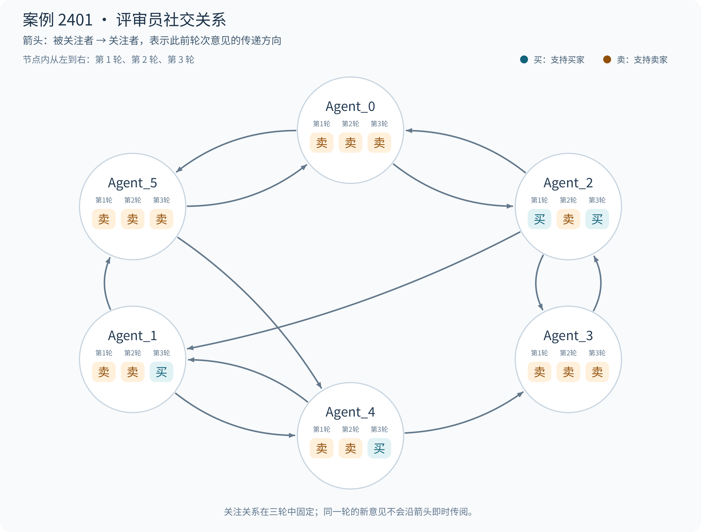

# 案例 2401：鞋底磨损争议中的多轮证据权衡

[English](README.md) | 简体中文

**最终预测：支持卖家；参考结果：支持买家。** 这起二手跑鞋纠纷中，鞋底照片的差异被解释为买家调包。第三轮已有三位评审员转向买家，模型仍支持卖家。

**原始人工投票：支持买家 15 票，支持卖家 2 票。** 下文六位系统评审员的三轮意见单独列出。

## 1. 案情与争议焦点

商品为 58 元、43 码的二手阿迪达斯跑鞋，商品页写有“二手物品”“明显穿着痕迹”。买家认为收到的鞋子存在未披露的瑕疵；卖家以鞋底照片差异指控调包；买家随后补充鞋舌标签回应商品身份争议。

| 阶段／来源 | 主张与证据 | 争议焦点 |
| --- | --- | --- |
| 商品页／卖方 | 58 元二手跑鞋；承认明显穿着痕迹，附实物照片。 | 收到鞋子的磨损程度是否已充分披露？ |
| 第一轮／买方 | 申请退款，称“完全没有说明瑕疵问题”，提交鞋底图。 | 实物磨损是否超出商品页展示的范围？ |
| 第二轮／卖方 | 拒绝退款；以防滑纹、底色和标志差异指控调包。 | 照片是否对应同一只鞋、同一部位？ |
| 第三轮／买方 | 申请介入，称“鞋舌标还有假吗”，补充标签等图片。 | 标签与商品页是否一致，是否支持商品身份核对？ |

### 鞋底照片

*图 1：商品页斜拍一只鞋底，另一只鞋底没有展示。*

*图 2：买家提交的鞋底照片，可见明显磨损和黑色区域。*

两张照片的角度和展示范围不同，比较纹路、颜色前需要核对同一只鞋、同一部位。

### 鞋舌标签

*图 3：商品页原有的鞋舌标签。*

*图 4：买家第三轮补充的标签照片，与图 3 中多项可辨的尺码、货号和编码信息一致。*

这组标签为核对商品身份、评估调包指控提供了新线索。

## 2. 评审员之间的社交关系

每位评审员固定关注另外两人。图中 **B → A 表示 A 关注 B，可以读取 B 在此前轮次的意见**。节点内依次列出第一、二、三轮的立场。

[English figure](images/social_network.en.png)

**Agent_2 的两次转向：** 第一轮只有它支持买家。它关注的 Agent_0、Agent_3 都支持卖家；第二轮新增卖方的对比证据后，Agent_2 也以“证据链指向商品非卖家发出”支持卖家。第三轮收到标签等新证据后，它再次转向买家，形成买家 → 卖家 → 买家的轨迹。

**第三轮的分歧：** Agent_1、Agent_4 也转向买家；它们所关注的评审员在上一轮都支持卖家，说明关注不等于跟随邻居投票。Agent_0、Agent_3、Agent_5 始终支持卖家。六位评审员的买家∶卖家人数从 1∶5、0∶6 变为 3∶3。

## 3. GNNExplainer：空间与时间层面的解释

GNNExplainer 从空间与时间两个层面追踪当前卖家裁决所保留的消息：空间连接聚合案件摘要与评审意见，时间连接传递较早轮次的表示。下面先展示消息对应的原始内容，再通过分别屏蔽不同消息组，检验它们与裁决变化的关系。

### 空间层面：阶段内信息聚合

**所选空间消息包含案件摘要和评审意见两部分。** 27 条消息中，18 条为案件摘要 → 评审员消息，覆盖三轮；另外 9 条为评审员之间的消息，其来源评审员在对应轮次均支持卖家。后者的理由主要有两类：认为磨损属于二手商品正常状态、已得到披露，以及将照片差异解释为商品被调包。下文将这两类空间消息分别屏蔽，检验其作用。

下表列出 GNNExplainer 识别的关键空间连接；箭头表示信息传递方向，掩码值表示消息在解释中的保留程度。

| 空间消息 | 掩码值 | 来源意见或案件摘要 |
| --- | --- | --- |
| 第 1 轮：Agent_5 → Agent_4 | 0.9982 | [支持卖家](#opinion-1-5)：“若初始描述已如实告知或图示已展示该状态” |
| 第 2 轮：Agent_3 → Agent_2 | 0.9982 | [支持卖家](#opinion-2-3)：“高度疑似“调包”” |
| 第 3 轮：Agent_3 → Agent_2 | 0.9981 | [支持卖家](#opinion-3-3)：“高度疑似买家调包或自行使用” |
| 第 3 轮：Agent_5 → Agent_4 | 0.9977 | [支持卖家](#opinion-3-5)：“实物状态发生根本性改变，远超正常二手损耗” |
| 第 3 轮：Case → Agent_3 | 0.9962 | 案件争点：“商品是否描述不符及是否存在调包行为。” |

**上游意见仍存在事实对应和推断缺陷，最终聚合也未纠正错误预测。** 第三轮，[Agent_3](#opinion-3-3)将鞋底照片差异解释为“高度疑似买家调包或自行使用”，[Agent_5](#opinion-3-5)则将前两轮对比视为“确证”，据此认定商品状态发生根本变化。现有对比尚未核实是否对应同一只鞋、同一部位，从视觉差异推到调包判断仍存在推断跳跃。

这些意见也进入了已转向买家的节点：[Agent_2](#opinion-3-2)、[Agent_4](#opinion-3-4)的第三轮原始意见已支持买家，但 GNNExplainer 选中的 Agent_3 → Agent_2（0.9981）、Agent_5 → Agent_4（0.9977）仍将上述卖方理由纳入它们的节点表示；同轮还选中了 Agent_5 → Agent_0（0.9977）。因此，用于裁决的节点表示同时包含买方观点与上述卖方推断。这些来源意见参与节点聚合，模型最终仍输出卖家裁决，与参考结果不一致。

**偶数评审员允许平票，本例无法直接沿用末轮多数票。** 六名评审员在第三轮形成 3∶3，任何一方都没有人数优势，因此“读取末轮多数立场”在本例中不能直接给出裁决。模型通过案件信息、评审理由及跨轮信息的聚合形成最终表示，再作出分类；这一过程超出了简单统计支持人数。

### 时间层面：跨阶段信息传递

时间消息把同一节点较早轮次的表示传到后续轮次，其中已包含空间聚合的信息。**时间掩码表示解释器对原有消息的保留程度**，数值越接近 1，保留越完整。

**时间掩码最高的 5 条连接。** 在所有参与解释的跨轮连接中，按逐层、逐头的掩码值降序排列；为区分相近数值，保留六位小数。

| 排名 | 时间消息 | 掩码值（层／头） | 两轮原始意见 |
| --- | --- | --- | --- |
| 1 | Agent_1：第 1 → 3 轮 | 0.999037（L1/H1） | [支持卖家](#opinion-1-1) → [支持买家](#opinion-3-1)：由正常二手使用痕迹的判断，转向认为商品特征发生根本性逆转。 |
| 2 | Agent_5：第 1 → 2 轮 | 0.998393（L1/H0） | [支持卖家](#opinion-1-5) → [支持卖家](#opinion-2-5)：由磨损已披露的条件判断，转向以照片差异支持调包指控。 |
| 3 | Agent_2：第 1 → 3 轮 | 0.998274（L1/H1） | [支持买家](#opinion-1-2) → [支持买家](#opinion-3-2)：均关注磨损是否超出描述及卖家是否充分告知。 |
| 4 | Agent_4：第 1 → 3 轮 | 0.998267（L1/H1） | [支持卖家](#opinion-1-4) → [支持买家](#opinion-3-4)：由适度磨损正常的判断，转向认为商品严重不符合描述。 |
| 5 | Agent_3：第 1 → 3 轮 | 0.998236（L1/H1） | [支持卖家](#opinion-1-3) → [支持卖家](#opinion-3-3)：由正常二手磨损的判断，转向怀疑买家调包或自行使用。 |

最高的是 **Agent_1 第 1 → 3 轮（0.999037）**，其两轮立场为“卖 → 买”。排名靠前的连接同时覆盖“卖 → 买”“买 → 买”和“卖 → 卖”，显示解释保留了不同立场演变中的跨轮信息。

**第三轮由卖家转向买家的 3 位评审员，时间掩码同样很高。** 下表分别列出它们第 2 → 3 轮连接在各层、各头中的最大掩码。

| 时间消息 | 掩码值（层／头） | 对应意见 |
| --- | --- | --- |
| Agent_2：第 2 → 3 轮 | 0.998115（L1/H1） | [支持卖家](#opinion-2-2) → [支持买家](#opinion-3-2)：“证据链指向商品非卖家发出” → “核心在于商品状态是否严重不符” |
| Agent_4：第 2 → 3 轮 | 0.998107（L1/H1） | [支持卖家](#opinion-2-4) → [支持买家](#opinion-3-4)：“无法排除调包可能” → “符合‘严重不符合描述’的核退标准” |
| Agent_1：第 2 → 3 轮 | 0.998099（L2/H1） | [支持卖家](#opinion-2-1) → [支持买家](#opinion-3-1)：“高度疑似商品被调包” → “特征发生根本性逆转” |

**关键在于这些高掩码保留了哪些历史信息。** Agent_1、Agent_2、Agent_4 在第三轮转向买家，但上述第 2 → 3 轮通路接入的是第二轮的历史表示；三者在第二轮均支持卖家，理由分别涉及“高度疑似商品被调包”“证据链指向商品非卖家发出”和“无法排除调包可能”。因此，第三轮立场转向买家的同时，关于商品身份的既有争议仍通过时间连接参与末轮计算。

**空间与时间连接展示了不同来源的信息如何汇合。** 第三轮 Agent_2、Agent_4 的买方意见，与邻居的卖方理由、案件摘要及历史表示共同参与聚合。要判断裁决对哪一类消息更敏感，需要将案件摘要消息、评审员消息和时间消息分别进行对照。

**分组屏蔽进一步定位到案件摘要的空间通路。** 使用相同的模型、输入及已学习的掩码进行前向对照。空间集合包含上述 27 条消息，时间集合包含按层、按头计的 43 条所选跨轮消息；屏蔽某一组时，其余消息保持开启。表中分差为卖家分类分数减去买家分类分数（logit）：正值判卖家，负值判买家。

| 消息干预 | 卖家 − 买家分差 | 模型裁决 |
| --- | --- | --- |
| 原始输入 | +3.1703 | 支持卖家 |
| 仅保留所选空间与时间消息 | +4.9187 | 支持卖家 |
| 仅屏蔽所选 27 条空间消息，时间保持不变 | −5.5237 | 支持买家 |
| 仅屏蔽所选 9 条评审员 → 评审员消息 | +3.1821 | 支持卖家 |
| 仅屏蔽所选 18 条案件摘要 → 评审员消息 | −4.5737 | 支持买家 |
| 仅屏蔽所选跨轮时间消息，空间保持不变 | +2.4854 | 支持卖家 |
| 屏蔽全部跨轮时间消息，空间保持不变 | +2.1169 | 支持卖家 |
| 同时屏蔽所选空间与时间消息 | −5.3918 | 支持买家 |

**在这些分组对照中，裁决翻转与案件摘要空间消息的移除更直接相关。** 单独屏蔽 18 条案件摘要 → 评审员消息，分差由 +3.1703 变为 −4.5737；单独屏蔽 9 条评审员之间的消息，分差仍为 +3.1821。由此可将当前卖家裁决的关键解释进一步定位到案件摘要汇入评审员节点的空间通路，而非仅依据来源支持卖家的评审员边数判断。

**时间消息影响了输出分差，但单独屏蔽并未改变类别。** 屏蔽全部跨轮时间消息后，分差降至 +2.1169，仍判卖家。因此，本例不宜归结为“历史错误意见压倒新证据”：这些对照识别的是消息组层面的作用，其中 18 条案件摘要消息覆盖三轮，具体轮次和摘要内容可进一步分别检验。

**后续改进方向：**

- **加强上游事实核对与推断检查。** 区分商品页、发货前与收货后的证据，对齐同一只鞋、同一部位，并比对鞋舌标签字段；在生成理由时区分可观察事实、条件判断与调包推测，避免将收货后的磨损直接当作售前已披露的依据。
- **进一步检查案件摘要的证据覆盖与事实对应。** 通过分轮对照分析其在最终聚合中的作用。
- **通过分轮、分消息类型的对照验证改进。** 固定其他输入，分别修订各轮摘要、调整案件摘要消息及评审员消息，比较裁决分差和理由的证据一致性。对 Agent_1、Agent_2、Agent_4 的第三轮转向，重点核查其新增理由，再在更多案例上检验哪些阶段和信息调整能够改善裁决。

## 4. 六位评审员三轮裁决原文

<table id="juror-opinions" style="display: table; table-layout: fixed; width: 100%; min-width: 1100px; border-collapse: collapse;">
<colgroup><col style="width: 76px;"><col span="6"></colgroup>
<thead><tr>
<th scope="col" valign="top" style="vertical-align: top; text-align: left; padding: 10px; overflow-wrap: anywhere; line-height: 1.55;">轮次</th>
<th scope="col" valign="top" style="vertical-align: top; text-align: left; padding: 10px; overflow-wrap: anywhere; line-height: 1.55;">Agent_0</th>
<th scope="col" valign="top" style="vertical-align: top; text-align: left; padding: 10px; overflow-wrap: anywhere; line-height: 1.55;">Agent_1</th>
<th scope="col" valign="top" style="vertical-align: top; text-align: left; padding: 10px; overflow-wrap: anywhere; line-height: 1.55;">Agent_2</th>
<th scope="col" valign="top" style="vertical-align: top; text-align: left; padding: 10px; overflow-wrap: anywhere; line-height: 1.55;">Agent_3</th>
<th scope="col" valign="top" style="vertical-align: top; text-align: left; padding: 10px; overflow-wrap: anywhere; line-height: 1.55;">Agent_4</th>
<th scope="col" valign="top" style="vertical-align: top; text-align: left; padding: 10px; overflow-wrap: anywhere; line-height: 1.55;">Agent_5</th>
</tr></thead>
<tbody>
<tr data-stage="1" valign="top">
<th scope="row" valign="top" style="vertical-align: top; text-align: left; padding: 10px; overflow-wrap: anywhere; line-height: 1.55; white-space: nowrap;">第 1 轮</th>
<td data-agent="0" id="opinion-1-0" valign="top" style="vertical-align: top; text-align: left; padding: 10px; overflow-wrap: anywhere; line-height: 1.55;"><!-- opinion:start stage=1 agent=0 -->结论：支持卖家 理由：买家主张“未说明瑕疵”与物证严重不符。图片清晰显示鞋底存在明显磨损及严重使用痕迹，这属于二手商品正常损耗。卖家若未在沟通中刻意隐瞒，则已履行告知义务。根据规则，非重大质量问题的使用痕迹不构成描述不符。买家因忽视商品展示图及实物状态申请退货，缺乏事实依据，应予驳回。<!-- opinion:end stage=1 agent=0 --></td>
<td data-agent="1" id="opinion-1-1" valign="top" style="vertical-align: top; text-align: left; padding: 10px; overflow-wrap: anywhere; line-height: 1.55;"><!-- opinion:start stage=1 agent=1 -->结论：支持卖家 理由：买家主张“未说明瑕疵”，但实物图显示鞋底严重磨损且沾有污渍。根据规则，二手商品存在明显使用痕迹属正常现象，若卖家发货前已展示实物或沟通中提示，则买家下单即视为认可该状态。目前证据仅证实商品有旧，未证明存在“严重质量问题”或卖家“刻意隐瞒”。依据规则中关于瑕疵告知及描述相符的判定，买家因预期偏差申请退款，非必要情况应予驳回，故倾向支持卖家。<!-- opinion:end stage=1 agent=1 --></td>
<td data-agent="2" id="opinion-1-2" valign="top" style="vertical-align: top; text-align: left; padding: 10px; overflow-wrap: anywhere; line-height: 1.55;"><!-- opinion:start stage=1 agent=2 -->结论：支持买家 理由：依据规则，商品应“严重不符合描述”方可退货。证据显示鞋子存在严重磨损（鞋底黑色痕迹），属于明显使用痕迹。若卖家未提前告知此瑕疵，则构成“刻意隐瞒实情”或“描述不符”。除非卖家能提供发货前商品全新的视觉证据证明已尽告知义务，否则买家因收到非全新商品而主张退款，符合平台对质量与描述一致性的判定标准，应支持买家诉求。<!-- opinion:end stage=1 agent=2 --></td>
<td data-agent="3" id="opinion-1-3" valign="top" style="vertical-align: top; text-align: left; padding: 10px; overflow-wrap: anywhere; line-height: 1.55;"><!-- opinion:start stage=1 agent=3 -->结论：支持卖家 理由：依据规则，二手商品存在使用痕迹属正常现象。买家提供的图片显示鞋底严重磨损且侧面可见 GORE-TEX 标识，直接证明商品为已使用的旧鞋。若卖家发货时如实展示了商品磨损状态及材质特征，则履行了告知义务。买家以“未说明瑕疵”为由拒收，实为未仔细查验商品现状导致预期偏差。在无证据表明卖家刻意隐瞒或拍 A 发 B 的情况下，非严重质量问题的描述不符诉求应驳回。<!-- opinion:end stage=1 agent=3 --></td>
<td data-agent="4" id="opinion-1-4" valign="top" style="vertical-align: top; text-align: left; padding: 10px; overflow-wrap: anywhere; line-height: 1.55;"><!-- opinion:start stage=1 agent=4 -->结论：支持卖家  理由：依据规则，二手商品存在适度磨损属正常现象，除非卖家刻意隐瞒重大瑕疵。虽买家主张“未说明瑕疵”，但证据显示商品侧面有 GORE-TEX 标识，侧面印证其具备防水功能，且鞋底磨损与污渍未达“严重质量问题”或“拍 A 发 B"程度。在无开箱视频佐证及卖家承认隐瞒的情况下，仅凭外观陈旧无法认定描述不符，故驳回退款。<!-- opinion:end stage=1 agent=4 --></td>
<td data-agent="5" id="opinion-1-5" valign="top" style="vertical-align: top; text-align: left; padding: 10px; overflow-wrap: anywhere; line-height: 1.55;"><!-- opinion:start stage=1 agent=5 -->结论：支持卖家 理由：买家主张“完全未说明瑕疵”与图片中显示的明显磨损、污渍及 GORE-TEX 标识相悖。依据规则，二手商品存在明显磨损属正常现象，除非卖家刻意隐瞒全新状态。当前证据显示商品存在显著使用痕迹，若初始描述已如实告知或图示已展示该状态，则买家因未细看描述而事后退货，不符合“严重不符”或“隐瞒实情”的核退标准，应驳回其诉求。<!-- opinion:end stage=1 agent=5 --></td>
</tr>
<tr data-stage="2" valign="top">
<th scope="row" valign="top" style="vertical-align: top; text-align: left; padding: 10px; overflow-wrap: anywhere; line-height: 1.55; white-space: nowrap;">第 2 轮</th>
<td data-agent="0" id="opinion-2-0" valign="top" style="vertical-align: top; text-align: left; padding: 10px; overflow-wrap: anywhere; line-height: 1.55;"><!-- opinion:start stage=2 agent=0 -->结论：支持卖家 理由：根据“多模态细节优先”规则，对比双方实物证据，卖家发货前照片显示鞋底标志为紫色且完好，而买家寄回照片显示标志变为红色且严重磨损，防滑纹与颜色均不一致。这种关键特征的根本性差异，强有力地佐证了买家主张的“拍 A 发 B"或恶意调包。在此情况下，买家以商品瑕疵为由申请退货，缺乏事实基础，且存在欺诈嫌疑，应驳回其诉求。<!-- opinion:end stage=2 agent=0 --></td>
<td data-agent="1" id="opinion-2-1" valign="top" style="vertical-align: top; text-align: left; padding: 10px; overflow-wrap: anywhere; line-height: 1.55;"><!-- opinion:start stage=2 agent=1 -->结论：支持卖家 理由：依据规则，需比对发货与收货状态以判定是否“拍 A 发 B"。卖家提供的发货前照片显示鞋底标识清晰、防滑纹完整且颜色正常；而买家退回照片显示防滑纹磨平、标识严重磨损且鞋底变色。双方实物状态存在根本性差异，远超正常二手磨损范畴，高度疑似商品被调包。在买家无法提供开箱视频佐证原貌，且实物证据与卖家发货记录严重矛盾的情况下，应认定卖家描述相符，驳回买家退款。<!-- opinion:end stage=2 agent=1 --></td>
<td data-agent="2" id="opinion-2-2" valign="top" style="vertical-align: top; text-align: left; padding: 10px; overflow-wrap: anywhere; line-height: 1.55;"><!-- opinion:start stage=2 agent=2 -->结论：支持卖家 理由：依据规则，需证实“严重不符”或“刻意隐瞒”方可退货。卖家举证发货前鞋底防滑纹清晰、颜色黄绿相间及标识模糊；买家退货后鞋底全黄、磨损殆尽且标识清晰。双方关键特征（防滑纹、颜色、标识）存在根本性视觉矛盾，高度疑似“发错货”或“掉包”。在无开箱视频佐证下，买家提供的严重磨损状态与其描述不符的特征无法解释，反证卖家已尽告知义务。证据链指向商品非卖家发出，故驳回买家诉求。<!-- opinion:end stage=2 agent=2 --></td>
<td data-agent="3" id="opinion-2-3" valign="top" style="vertical-align: top; text-align: left; padding: 10px; overflow-wrap: anywhere; line-height: 1.55;"><!-- opinion:start stage=2 agent=3 -->结论：支持卖家 理由：依据规则，需核实是否为同一商品。卖家举证发货前鞋底标志清晰完整，与买家退回照片中标志磨损、颜色及 Logo 形态存在显著差异，高度疑似“调包”或“拍 A 发 B"。在无开箱视频佐证买家验货状态，且退回物证与发货物证特征不符的情况下，买家主张的“描述不符”缺乏基础，应驳回其诉求以维护交易诚信。<!-- opinion:end stage=2 agent=3 --></td>
<td data-agent="4" id="opinion-2-4" valign="top" style="vertical-align: top; text-align: left; padding: 10px; overflow-wrap: anywhere; line-height: 1.55;"><!-- opinion:start stage=2 agent=4 -->结论：支持卖家 理由：核心争议在于商品是否“拍 A 发 B"。证据显示买家鞋底磨损严重且标识为红色"TRAXION"，而卖家发货前照片显示鞋底完好且标识为紫色，两者存在显著差异。根据规则，若实物与描述严重不符或疑似掉包，买家需提供确凿证据。当前多模态物证直接证明返还商品与发货商品特征不一致，且买家未拍摄开箱视频，无法排除调包可能。在无反向证据推翻卖家主张下，应认定商品严重不符，驳回退款。<!-- opinion:end stage=2 agent=4 --></td>
<td data-agent="5" id="opinion-2-5" valign="top" style="vertical-align: top; text-align: left; padding: 10px; overflow-wrap: anywhere; line-height: 1.55;"><!-- opinion:start stage=2 agent=5 -->结论：支持卖家 理由：依据规则，若商品符合描述且卖家已履行告知义务，非重大质量问题不应退货。本轮物证显示，买家寄回鞋底严重磨损、颜色发黄且标识受损，与卖家发货前展示的清晰纹路、偏绿底色及完整标识存在显著差异。多模态视觉证据证实实物状态发生实质性改变，符合卖家“拍 A 发 B"或物品被调包的指控。鉴于卖家已提供发货前对比图，买家无法证明收到商品即严重不符描述，其退货诉求缺乏事实基础，应予驳回。<!-- opinion:end stage=2 agent=5 --></td>
</tr>
<tr data-stage="3" valign="top">
<th scope="row" valign="top" style="vertical-align: top; text-align: left; padding: 10px; overflow-wrap: anywhere; line-height: 1.55; white-space: nowrap;">第 3 轮</th>
<td data-agent="0" id="opinion-3-0" valign="top" style="vertical-align: top; text-align: left; padding: 10px; overflow-wrap: anywhere; line-height: 1.55;"><!-- opinion:start stage=3 agent=0 -->结论：支持卖家 理由：依据规则，二手商品存在使用痕迹属正常现象，除非卖家刻意隐瞒。本案关键物证显示，买家寄回鞋子虽鞋底有磨损，但鞋舌标清晰且快递流向明确（卖家寄出、买家寄回），未呈现“拍 A 发 B"或调包的确凿证据。前轮已证实卖家发货前商品状态与买家主张的“全新/严重不符”存在视觉矛盾。买家仅以磨损为由，无法证明卖家存在欺诈或隐瞒实情，不符合核退标准，故驳回其诉求。<!-- opinion:end stage=3 agent=0 --></td>
<td data-agent="1" id="opinion-3-1" valign="top" style="vertical-align: top; text-align: left; padding: 10px; overflow-wrap: anywhere; line-height: 1.55;"><!-- opinion:start stage=3 agent=1 -->结论：支持买家 理由：依据规则，二手交易虽容许适度磨损，但若存在“严重不符合描述”或“拍 A 发 B"仍可退货。前两轮证据显示发货商品防滑纹完整、标识颜色特异（紫/黄绿），而本轮买家实物图证实鞋面磨损严重且鞋底全黄、防滑纹缺失，特征发生根本性逆转，高度疑似“拍 A 发 B"。鉴于卖家无法提供开箱视频以自证清白，且实物状态与发货记录严重矛盾，买家证据链完整，应认定卖家履约存在重大过失，支持退款。<!-- opinion:end stage=3 agent=1 --></td>
<td data-agent="2" id="opinion-3-2" valign="top" style="vertical-align: top; text-align: left; padding: 10px; overflow-wrap: anywhere; line-height: 1.55;"><!-- opinion:start stage=3 agent=2 -->结论：支持买家 理由：依据规则，核心在于商品状态是否严重不符。证据显示退回商品鞋底严重磨损发黑，鞋舌标签为 US 9。此视觉特征表明买家确实收到了“已使用”的旧鞋，若卖家描述为全新或仅展示轻微痕迹，则构成“严重不符合描述”且涉嫌“刻意隐瞒实情”。尽管前两轮存在调包质疑，但退回物证与卖家发货状态存在根本性视觉矛盾（磨损度、标签细节），在无开箱视频佐证下，买家收到的非描述内商品事实确凿，满足退货条件。<!-- opinion:end stage=3 agent=2 --></td>
<td data-agent="3" id="opinion-3-3" valign="top" style="vertical-align: top; text-align: left; padding: 10px; overflow-wrap: anywhere; line-height: 1.55;"><!-- opinion:start stage=3 agent=3 -->结论：支持卖家 理由：依据规则，二手交易非全新属正常，退货需“严重不符”或“拍 A 发 B"且证据确凿。前序证据已证实退回鞋底磨损特征与卖家发货前照片存在根本性视觉矛盾，高度疑似买家调包或自行使用，而非商品本身描述不符。买家仅提供磨损照片无法推翻“发错货/掉包”的合理怀疑，且无开箱视频佐证收货状态，不符合平台退货条件，故驳回其诉求。<!-- opinion:end stage=3 agent=3 --></td>
<td data-agent="4" id="opinion-3-4" valign="top" style="vertical-align: top; text-align: left; padding: 10px; overflow-wrap: anywhere; line-height: 1.55;"><!-- opinion:start stage=3 agent=4 -->结论：支持买家 理由：依据规则，多模态证据显示实物鞋舌有手写"1 号”标记且鞋底磨损严重，此特征与卖家发货前展示的清晰完好状态存在根本性差异，直接佐证“拍 A 发 B"或严重描述不符。鉴于卖家无法合理解释该新增标记来源及状态突变，且买家举证形成了完整证据链，符合“严重不符合描述”的核退标准，故认定卖家履约存在重大过失，支持买家诉求。<!-- opinion:end stage=3 agent=4 --></td>
<td data-agent="5" id="opinion-3-5" valign="top" style="vertical-align: top; text-align: left; padding: 10px; overflow-wrap: anywhere; line-height: 1.55;"><!-- opinion:start stage=3 agent=5 -->结论：支持卖家 理由：依据规则，多模态细节优先。前两轮确证发货商品鞋底纹路清晰、底色偏绿、标识完整；而本轮买家举证显示鞋底严重磨损沾污、标识变红。实物状态发生根本性改变，远超正常二手损耗，符合“拍 A 发 B"或调包特征。卖家已履行告知义务且发货描述相符，买家无法证明收到即严重不符，其以瑕疵为由退货缺乏事实依据，应驳回。<!-- opinion:end stage=3 agent=5 --></td>
</tr>
</tbody></table>

