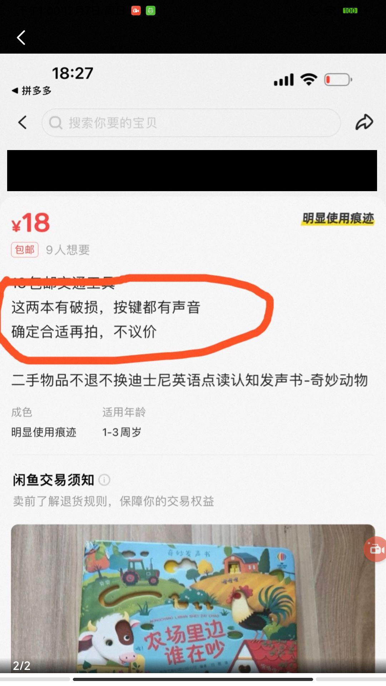

# Case 2588: Disclosed damage and the scope of disclosure, correctly supporting the seller

English | [简体中文](README.zh-CN.md)

**Final prediction: supports the seller; reference outcome: supports the seller.** After receiving a used sound book, the buyer argued that the damage exceeded what had been shown before purchase. The seller emphasized the damage disclosed in the listing and the video provided. Four of the six jurors ultimately supported the buyer and two supported the seller; ChronoJury integrated the case information and three rounds of opinions and supported the seller.

**Original human votes: 8 for the buyer, 9 for the seller.** The six system jurors’ opinions across three rounds are listed separately below.

## Case facts and key evidence

The buyer purchased one used sound book, *Who Is Making Noise on the Farm?*, for an agreed price of CNY 15.50 including shipping. The listing described two books and stated, “Both books have damage; all buttons produce sounds” and “Order only after confirming they are suitable.” The buyer requested a return and refund, arguing that damage to the spine, cover, and inner pages had not been fully shown in the presale video. The seller refused, saying it had been disclosed before the order. The dispute concerns **whether the disclosed damage covered the actual severity and whether the presale video provided sufficient disclosure**.

| Round | Materials in this round | How the dispute developed |
| --- | --- | --- |
| 1 | The buyer submitted photographs of the received item and requested a return. The seller submitted presale communications and the listing. The buyer also submitted the seller’s original video, arguing that it did not show the actual damage. | The existence of damage was largely undisputed. The parties began disputing whether the listing and video provided sufficient disclosure. |
| 2 | The buyer explicitly acknowledged that the video showed some damage but said it omitted the most severe part, and added a close-up of the separated spine. The seller resubmitted the listing and video, including screenshots. | The dispute narrowed to the scope of disclosure: despite the “damaged” label, was severe damage still inadequately disclosed? |
| 3 | The seller submitted an annotated version of the same damage photograph and the listing, argued that the camera angle exaggerated the damage, and stated that all ten buttons produced sounds and the battery had been replaced. The buyer said the photographs objectively showed the condition received. | The parties added explanations and again compared the damage with the disclosure, continuing to dispute its severity and the book’s function. |

**Figure 1 | Presale disclosure in the listing (account details redacted).** The listing states “damaged” and “obvious signs of use.” This screenshot was resubmitted in round 3; the same disclosure had appeared in the first two rounds.

**Figure 2 | A frame from the seller’s video.** The screenshot submitted in round 2 shows wear and tape repairs along the inner-page seam, with a finger pressing the sound area.

**Figure 3 | The severity emphasized by the buyer.** The round 2 close-up shows clear separation where the spine, cover, and inner pages connect. In round 3, the seller circled the same photograph and replied that “a little glue will fix it.”

## Social relationships and changes in stance

Each juror follows two other jurors. **B → A means that A follows B and can read B’s opinions from earlier rounds.** The three entries in each node show its stances in rounds 1, 2, and 3.

[Chinese figure](images/social_network.png)

The numbers supporting the buyer and seller were **3:3 → 4:2 → 4:2**. Agent_1 and Agent_2 supported the buyer throughout, while Agent_4 consistently supported the seller. In round 2, Agent_0 and Agent_3 switched to the buyer and Agent_5 switched to the seller; all maintained their positions in round 3.

**Agent_5’s change and the continuity of the seller’s argument.** Both jurors it follows, Agent_0 and Agent_4, supported the seller in round 1, emphasizing the damage disclosed in the listing. In round 2, Agent_5 could read these historical opinions and also saw the new listing, video, and damage images. It then moved from “severe damage was not shown” to “the listing and video provided disclosure.” Agent_4 still supported the seller in round 3, even though both jurors it follows, Agent_0 and Agent_3, had switched to the buyer in round 2.

**Continuity of the buyer’s argument.** The two jurors followed by Agent_0 held different positions in round 1; both jurors followed by Agent_3 supported the buyer. Agent_0 and Agent_3 switched to the buyer in round 2, reasoning that the word “damaged” did not adequately cover severe damage such as the separated spine. Two interpretations persisted into the final round: one emphasized prior disclosure, while the other emphasized inadequate disclosure of the specific severity.

## GNN explanation: how the correct decision was formed

**The listing explicitly disclosed damage, and the presale video showed repairs; the dispute was whether this disclosure covered the actual severity.** The model integrated materials from all three rounds and supported the seller, matching the human reference outcome of 9 votes for the seller to 8 for the buyer. The following spatial and temporal explanations describe how the verdict was formed.

### Spatial dimension

Spatial messages retained both the seller’s argument that damage had been disclosed and the buyer’s dispute over adequate disclosure, with the case summary incorporated in round 3.

The table lists key spatial connections identified by GNNExplainer. Arrows show information flow in the model; mask values indicate how much each message is retained in the explanation.

| Spatial message | Mask value | Source opinion or case summary |
| --- | --- | --- |
| Round 1: Agent_4 → Agent_0 | 0.9978 | [Supports the seller](#opinion-1-4): “the seller’s listing explicitly states “damaged”” |
| Round 2: Agent_4 → Agent_5 | 0.9981 | [Supports the seller](#opinion-2-4): “The listing explicitly states ‘damaged’ and ‘no returns or exchanges,’ constituting valid disclosure.” |
| Round 3: Case → Agent_4 | 0.9955 | Case issue: “Whether the seller fully showed the damage and whether the buyer gave informed consent.” |

These connections incorporate the seller-supporting disclosure arguments into the verdict computation.

### Temporal dimension

Temporal messages connected Agent_4’s persistent disclosure rationale for supporting the seller, Agent_5’s switch from buyer to seller, and the subsequent dispute over the scope of disclosure.

| Temporal message | Mask value (layer / head) | Corresponding opinions or issue |
| --- | --- | --- |
| Agent_4: round 1 → 2 | 0.9982 (L1/H0) | [Supports the seller](#opinion-1-4) → [Supports the seller](#opinion-2-4): “the seller’s listing explicitly states “damaged”” → “the listing explicitly states “damaged”” |
| Agent_5: round 1 → 2 | 0.9984 (L1/H0) | [Supports the buyer](#opinion-1-5) → [Supports the seller](#opinion-2-5): “the seller’s video did not clearly show the details of this severe damage” → “the seller’s listing explicitly states “damaged”” |
| Case: round 2 → 3 | 0.9984 (L2/H1) | Issue: “Whether the seller adequately disclosed and showed all damage to the book, and whether the buyer’s right to be informed was harmed.” → “Whether the seller fully showed the damage and whether the buyer gave informed consent.” |

**The selected temporal message set is key to the model’s seller verdict.** The table shows representative connections from this set; with spatial messages unchanged, masking the full selected temporal set changes the verdict from seller to buyer.

## Each juror’s verdict and rationale in each round (English translations)

<table id="juror-opinions" style="display: table; table-layout: fixed; width: 100%; min-width: 1100px; border-collapse: collapse;">
<colgroup><col style="width: 76px;"><col span="6"></colgroup>
<thead><tr>
<th scope="col" valign="top" style="vertical-align: top; text-align: left; padding: 10px; overflow-wrap: anywhere; line-height: 1.55;">Round</th>
<th scope="col" valign="top" style="vertical-align: top; text-align: left; padding: 10px; overflow-wrap: anywhere; line-height: 1.55;">Agent_0</th>
<th scope="col" valign="top" style="vertical-align: top; text-align: left; padding: 10px; overflow-wrap: anywhere; line-height: 1.55;">Agent_1</th>
<th scope="col" valign="top" style="vertical-align: top; text-align: left; padding: 10px; overflow-wrap: anywhere; line-height: 1.55;">Agent_2</th>
<th scope="col" valign="top" style="vertical-align: top; text-align: left; padding: 10px; overflow-wrap: anywhere; line-height: 1.55;">Agent_3</th>
<th scope="col" valign="top" style="vertical-align: top; text-align: left; padding: 10px; overflow-wrap: anywhere; line-height: 1.55;">Agent_4</th>
<th scope="col" valign="top" style="vertical-align: top; text-align: left; padding: 10px; overflow-wrap: anywhere; line-height: 1.55;">Agent_5</th>
</tr></thead><tbody>
<tr data-stage="1" valign="top">
<th scope="row" valign="top" style="vertical-align: top; text-align: left; padding: 10px; overflow-wrap: anywhere; line-height: 1.55; white-space: nowrap;">Round 1</th>
<td data-agent="0" id="opinion-1-0" valign="top" style="vertical-align: top; text-align: left; padding: 10px; overflow-wrap: anywhere; line-height: 1.55;"><!-- opinion:start stage=1 agent=0 -->Conclusion: Supports the seller  Reason: Under the platform rules, defects in a used item do not constitute a mismatch with the description if they have been disclosed. The seller's evidence shows that the listing explicitly states "damaged" and specifies "no returns or exchanges," and the seller uploaded a video confirming the item before shipment. Although the item received by the buyer shows severe damage, including a torn spine and longitudinal tears in the inner pages, this falls within the disclosed defects. Seeking a refund on the grounds that the item did not meet the buyer's expectations, while questioning the authenticity of the video, runs counter to the principle that placing an order constitutes acceptance of the description. The buyer's claim lacks factual and regulatory support and should be rejected.<!-- opinion:end stage=1 agent=0 --></td>
<td data-agent="1" id="opinion-1-1" valign="top" style="vertical-align: top; text-align: left; padding: 10px; overflow-wrap: anywhere; line-height: 1.55;"><!-- opinion:start stage=1 agent=1 -->Conclusion: Supports the buyer Reason: Although the seller's listing states "no returns or exchanges," the platform rules do not allow this clause to exempt the seller from responsibility for serious quality problems or an item that does not match its description. The key evidence shows that the book is severely damaged and torn to the point that it cannot close. The buyer also points out that the seller's video did not accurately show the damage to the inner pages, suggesting deliberate concealment or incomplete filming. The item falls substantially below the basic condition expected in a secondhand transaction, constituting a material mismatch with its description. The buyer's evidence is conclusive and meets the conditions for a return and refund.<!-- opinion:end stage=1 agent=1 --></td>
<td data-agent="2" id="opinion-1-2" valign="top" style="vertical-align: top; text-align: left; padding: 10px; overflow-wrap: anywhere; line-height: 1.55;"><!-- opinion:start stage=1 agent=2 -->Conclusion: Supports the buyer Reason: Under the rules, a buyer may return an item that seriously differs from its description when the evidence is conclusive. The buyer's photographs and video clearly show a torn spine, inner pages that cannot close, and missing pages, amounting to severe physical damage. The seller argues that the damage was disclosed before the order, but the available evidence does not establish that the seller fully showed these severe defects. The buyer had not seen a video showing the obvious damage before accepting delivery. The seller therefore failed to disclose the defects, constituting a mismatch with the description.<!-- opinion:end stage=1 agent=2 --></td>
<td data-agent="3" id="opinion-1-3" valign="top" style="vertical-align: top; text-align: left; padding: 10px; overflow-wrap: anywhere; line-height: 1.55;"><!-- opinion:start stage=1 agent=3 -->Conclusion: Supports the seller Reason: The rules for secondhand transactions state that, when a seller has truthfully disclosed defects and fulfilled the duty of disclosure, minor damage is normal and is not grounds for a return. The evidence shows that the listing states "damaged" and that the seller supplied a video confirming the item's condition. After receiving the item, the buyer claims a serious quality problem on the grounds that it differs from the description. However, the actual damage matches the defects disclosed in the listing and reflects insufficient confirmation before receipt or a mismatch with the buyer's expectations. The buyer has not established that a different item was shipped or that facts were concealed, so the claim should be rejected.<!-- opinion:end stage=1 agent=3 --></td>
<td data-agent="4" id="opinion-1-4" valign="top" style="vertical-align: top; text-align: left; padding: 10px; overflow-wrap: anywhere; line-height: 1.55;"><!-- opinion:start stage=1 agent=4 -->Conclusion: Supports the seller Reason: Under the rules, if the seller has fulfilled the duty of disclosure and concealed nothing, the buyer cannot return the item for reasons unrelated to quality. The evidence shows that the seller's listing explicitly states "damaged" and "no returns or exchanges," and the chat also asks the buyer to confirm. Although the buyer's evidence shows obvious defects such as tears and tape repairs, these are disclosed characteristics of the used item, rather than serious quality problems or a case of ordering one item and receiving another. Applying directly for a refund because of unmet expectations or an insufficiently careful reading of the description does not meet the platform's definition of an item that differs from its description. The claim should therefore be rejected.<!-- opinion:end stage=1 agent=4 --></td>
<td data-agent="5" id="opinion-1-5" valign="top" style="vertical-align: top; text-align: left; padding: 10px; overflow-wrap: anywhere; line-height: 1.55;"><!-- opinion:start stage=1 agent=5 -->Conclusion: Supports the buyer Reason: Although the seller stated that the book was damaged and provided a video, the buyer's evidence of the received item shows a torn spine, longitudinal tears in the inner pages, and missing pages. This is severe physical damage, far beyond ordinary defects in a used item. The seller's video did not clearly show the details of this severe damage, suggesting concealment or a mismatch with the description. Under the rules, a serious quality problem supported by conclusive evidence warrants a return. The seller's defense that the buyer's expectations were not met should be rejected.<!-- opinion:end stage=1 agent=5 --></td>
</tr>
<tr data-stage="2" valign="top">
<th scope="row" valign="top" style="vertical-align: top; text-align: left; padding: 10px; overflow-wrap: anywhere; line-height: 1.55; white-space: nowrap;">Round 2</th>
<td data-agent="0" id="opinion-2-0" valign="top" style="vertical-align: top; text-align: left; padding: 10px; overflow-wrap: anywhere; line-height: 1.55;"><!-- opinion:start stage=2 agent=0 -->Conclusion: Supports the buyer  Reason: Although the seller states that the damage was disclosed, the shipping video shows only the cover and the flat parts of the inner pages, deliberately avoiding major defects such as the torn spine and the inability to close the inner pages. This raises concerns about incomplete presentation. Under the rules, when a video serves as key visual evidence but fails to disclose major defects fully, the seller has not adequately fulfilled the duty of disclosure. The severe physical damage discovered on receipt differs materially from the video, constituting a serious mismatch with the description and meeting the conditions for a return. The seller's reliance on the written description and lack of professional expertise cannot obscure the fact that the video omitted key details.<!-- opinion:end stage=2 agent=0 --></td>
<td data-agent="1" id="opinion-2-1" valign="top" style="vertical-align: top; text-align: left; padding: 10px; overflow-wrap: anywhere; line-height: 1.55;"><!-- opinion:start stage=2 agent=1 -->Conclusion: Supports the buyer Reason: Under the rules, the seller has a duty to disclose all defects in the item. The chat evidence shows that the buyer claims the seller's video deliberately concealed the most severely damaged area, while photographs confirm that the torn spine prevents the book from closing, a serious quality problem. The seller's assertion that the video showed the damage conflicts with the claim that the most severely damaged area was omitted, and the seller has not established adequate disclosure. As the item's actual condition differs substantially from the video, it materially fails to match its description. The buyer's complete chain of evidence meets the conditions for a return and compensation.<!-- opinion:end stage=2 agent=1 --></td>
<td data-agent="2" id="opinion-2-2" valign="top" style="vertical-align: top; text-align: left; padding: 10px; overflow-wrap: anywhere; line-height: 1.55;"><!-- opinion:start stage=2 agent=2 -->Conclusion: Supports the buyer Reason: Under the rules, the information presented by the seller must be complete and truthful. Although the listing states "damaged," the seller's video shows only minor defects and does not cover the severe damage received by the buyer, including a torn spine and broken inner pages. Omitting this critical damage caused the buyer to order on the basis of incomplete information, amounting to a mismatch with the description and concealment. The seller's instruction to refer to the video conflicts with its actual content. The seller failed to provide adequate disclosure, so the buyer's claim is reasonable.<!-- opinion:end stage=2 agent=2 --></td>
<td data-agent="3" id="opinion-2-3" valign="top" style="vertical-align: top; text-align: left; padding: 10px; overflow-wrap: anywhere; line-height: 1.55;"><!-- opinion:start stage=2 agent=3 -->Conclusion: Supports the buyer Reason: Under the rules, both the video and the listing are important evidence, but a video that deliberately conceals major defects constitutes a mismatch with the description. The evidence confirms the buyer's claim that the largest area of damage was not shown. The torn spine prevents the inner pages from closing, representing severe physical damage far beyond ordinary defects in a used item. Although the seller claims to have disclosed the damage, the seller has not established that the video fully showed this critical defect, suggesting concealment. As the major damage was not adequately disclosed before the transaction and seriously affects basic use, the conditions for a return and refund are met. The buyer's chain of evidence is complete and valid.<!-- opinion:end stage=2 agent=3 --></td>
<td data-agent="4" id="opinion-2-4" valign="top" style="vertical-align: top; text-align: left; padding: 10px; overflow-wrap: anywhere; line-height: 1.55;"><!-- opinion:start stage=2 agent=4 -->Conclusion: Supports the seller Reason: Under the rules, if the seller has fulfilled the duty of disclosure and concealed nothing, the buyer cannot return the item for reasons unrelated to quality. The listing explicitly states "damaged" and "no returns or exchanges," constituting valid disclosure. The buyer argues that the video did not show all the damage, but a different understanding of the video or unmet expectations does not establish deliberate concealment or the shipment of a different item. The tears and repairs visible on the item fall within the disclosed defects of a used item and meet the definition of matching the description. A refund claim based on unmet expectations lacks factual and regulatory support and should be rejected.<!-- opinion:end stage=2 agent=4 --></td>
<td data-agent="5" id="opinion-2-5" valign="top" style="vertical-align: top; text-align: left; padding: 10px; overflow-wrap: anywhere; line-height: 1.55;"><!-- opinion:start stage=2 agent=5 -->Conclusion: Supports the seller Reason: Under the rules, a return is not supported when the item matches its description and the seller has fulfilled the duty of disclosure. The evidence shows that the seller's listing explicitly states "damaged" and that a shipping video was uploaded, constituting complete disclosure. The buyer's claim that severe damage was not shown reflects unmet subjective expectations, rather than a mismatch with the description or deliberate concealment. As defects in a used item are normal and the seller has fulfilled the disclosure obligation, requesting a refund because the item does not meet the buyer's expectations conflicts with the rule that placing an order constitutes acceptance of the description. The claim should be rejected.<!-- opinion:end stage=2 agent=5 --></td>
</tr>
<tr data-stage="3" valign="top">
<th scope="row" valign="top" style="vertical-align: top; text-align: left; padding: 10px; overflow-wrap: anywhere; line-height: 1.55; white-space: nowrap;">Round 3</th>
<td data-agent="0" id="opinion-3-0" valign="top" style="vertical-align: top; text-align: left; padding: 10px; overflow-wrap: anywhere; line-height: 1.55;"><!-- opinion:start stage=3 agent=0 -->Conclusion: Supports the buyer  Reason: Under the platform rules, if the seller has shown a video, the buyer is presumed to accept it. The seller's shipping video shows only the cover and flat inner pages, deliberately avoiding major defects such as the torn spine and the inability to close the inner pages. This makes the presentation incomplete, constituting a mismatch with the description and inadequate disclosure. Although the listing mentions damage, the video, as key visual evidence, fails to portray the item's overall condition accurately, and the defense that glue will fix it does not address structural damage. The buyer's conclusive evidence establishes that the received item seriously differs from the description, meeting the conditions for a return and refund.<!-- opinion:end stage=3 agent=0 --></td>
<td data-agent="1" id="opinion-3-1" valign="top" style="vertical-align: top; text-align: left; padding: 10px; overflow-wrap: anywhere; line-height: 1.55;"><!-- opinion:start stage=3 agent=1 -->Conclusion: Supports the buyer Reason: Under the rules, although the seller marked the item as damaged and asked for confirmation, the seller must fully disclose serious defects. The evidence shows that the torn spine prevents the book from closing, which is severe physical damage far beyond ordinary defects in a used item. The seller's argument that the listing mentioned it does not establish that this critical damage was fully shown. The claim that a little glue will fix it also conflicts with the item's severe deformation, suggesting concealment. As the item's condition seriously differs from its description and affects its core function, the buyer's conclusive evidence meets the conditions for a return and refund.<!-- opinion:end stage=3 agent=1 --></td>
<td data-agent="2" id="opinion-3-2" valign="top" style="vertical-align: top; text-align: left; padding: 10px; overflow-wrap: anywhere; line-height: 1.55;"><!-- opinion:start stage=3 agent=2 -->Conclusion: Supports the buyer Reason: Under the rules, the seller must provide adequate disclosure. Although the listing states "damaged," the seller's video shows only minor defects and does not clearly present the severe damage received by the buyer, including the torn spine and broken inner pages. Omitting this critical damage caused the buyer to order on the basis of incomplete information, constituting a mismatch with the description. In comparison, the multimodal features of the physical evidence, namely severe tears, go far beyond minor damage. This establishes that the seller failed to disclose the item's true condition accurately, so the buyer's claim is reasonable.<!-- opinion:end stage=3 agent=2 --></td>
<td data-agent="3" id="opinion-3-3" valign="top" style="vertical-align: top; text-align: left; padding: 10px; overflow-wrap: anywhere; line-height: 1.55;"><!-- opinion:start stage=3 agent=3 -->Conclusion: Supports the buyer Reason: Under the rules, the seller must fully disclose defects. The key evidence shows that the torn spine prevents the book from closing, constituting severe physical damage far beyond the "minor damage" stated in the listing. The seller's argument that a little glue will fix it, together with the video's failure to show this critical defect, suggests deliberate concealment. As the item seriously differs from its description and its basic use is affected, it meets the return conditions for a serious mismatch with the description. The seller's defense should be rejected.<!-- opinion:end stage=3 agent=3 --></td>
<td data-agent="4" id="opinion-3-4" valign="top" style="vertical-align: top; text-align: left; padding: 10px; overflow-wrap: anywhere; line-height: 1.55;"><!-- opinion:start stage=3 agent=4 -->Conclusion: Supports the seller Reason: Under the rules, the seller fulfilled the duty of disclosure by explicitly stating "damaged" and "no returns or exchanges" in the listing. Both the video and the buyer's own photographs confirm that the torn spine and separated inner pages fall within the disclosed defects of a used item, rather than deliberate concealment or the shipment of a different item. The buyer invokes "a little glue will fix it" to claim a serious mismatch, but this is actually a rejection of a reasonable suggestion for dealing with the item's existing condition, rather than a functional defect or a mismatch with the description. As the seller did not act fraudulently and fulfilled the disclosure obligation, requesting a refund because of unmet expectations or disagreement over the severity of defects does not meet the rules for returns unrelated to quality. The claim should be rejected.<!-- opinion:end stage=3 agent=4 --></td>
<td data-agent="5" id="opinion-3-5" valign="top" style="vertical-align: top; text-align: left; padding: 10px; overflow-wrap: anywhere; line-height: 1.55;"><!-- opinion:start stage=3 agent=5 -->Conclusion: Supports the seller Reason: Under the rules, when defects in a used item have been clearly disclosed and there is no substantial concealment, the buyer cannot return it solely because expectations were not met. The seller marked the item as damaged and stated "no returns or exchanges," fulfilling the core disclosure obligation. Although the buyer shows a severely torn spine, it falls within the disclosed condition and is not a case of receiving a different item or deliberate concealment. The seller's evidence of normal operation and a replaced battery establishes that the item can be used normally and that there was no fraudulent intent. Challenging the description on the basis of the visual impact amounts to changing one's mind after failing to examine the item's condition carefully. This conflicts with the rule that placing an order constitutes acceptance, so the claim should be rejected.<!-- opinion:end stage=3 agent=5 --></td>
</tr>
</tbody></table>

