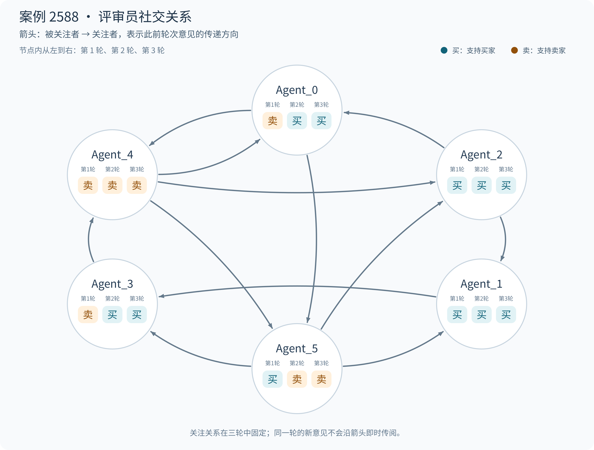

# 案例 2588：已披露的破损与展示范围之争，正确支持卖家

[English](README.md) | 简体中文

**最终预测：支持卖家；参考结果：支持卖家。** 买家收到二手发声书后认为破损程度超出了售前展示，卖家则强调页面已注明破损并提供视频。最终六位评审员中四位支持买家、两位支持卖家，ChronoJury 综合案件信息与三轮意见后支持卖家。

**原始人工投票：支持买家 8 票，支持卖家 9 票。** 下文六位系统评审员的三轮意见单独列出。

## 案情与关键证据

买家购买的是《农场里面谁在吵》一本二手发声书，协商价格为 15.50 元包邮。商品页面介绍了两本书，并写明“这两本有破损，按键都有声音”“确定合适再拍”。买家申请退货退款，主张实际收到的书脊、封皮和内页破损未在售前视频中充分展示；卖家以“下单前已告知”为由拒绝。争议集中于**已披露的破损是否涵盖实际损伤程度，以及售前视频展示是否充分**。

| 阶段 | 本轮材料 | 争议如何推进 |
| --- | --- | --- |
| 第一轮 | 买家提交收货照片并申请退货；卖家提交售前沟通和商品页面。买家也提交卖家原视频，指出视频没有展示实际破损。 | 双方对破损已存在没有根本分歧，开始争论页面说明与视频能否构成充分告知。 |
| 第二轮 | 买家明确承认视频展示过部分破损，但称最严重处没有展示，并补充书脊分离特写；卖家再次提交页面、视频及视频截图。 | 争点收窄为展示范围：书已标注“有破损”，是否仍存在未充分披露的严重损伤？ |
| 第三轮 | 卖家补交圈注后的同一损伤图和商品页面，主张拍摄角度放大了破损，并称十个按键都有声音、已换电池；买家回应照片客观反映收到的状态。 | 双方补充说明并再次对照损伤和告知内容，继续争论破损程度与功能。 |

**图 1｜商品页面的事前说明（账号信息已遮挡）。** 页面写明“有破损”，并标为“明显使用痕迹”。图示为第三轮再次提交的页面截图，相同说明在前两轮已出现。

**图 2｜卖家展示的视频画面。** 第二轮提交的截图中，内页中缝可见磨损和胶带修补痕迹，手指正在按压发声区域。

**图 3｜买家强调的破损程度。** 第二轮特写显示书脊、封皮与内页连接处明显分离。第三轮卖家对同一照片加圈标注，回应“胶粘一下就可以”。

## 社交关系与立场变化

每位评审员固定关注另外两人。**B → A 表示 A 关注 B，可以读取 B 在此前轮次的意见。** 节点中的三项依次表示第一、二、三轮的支持方。

[English figure](images/social_network.en.png)

支持买家与支持卖家的人数为 **3∶3 → 4∶2 → 4∶2**。Agent_1、Agent_2 始终支持买家，Agent_4 始终支持卖家；第二轮 Agent_0、Agent_3 转向买家，Agent_5 转向卖家，第三轮均保持各自立场。

**Agent_5 的转向与卖方论据的延续。** 它关注的 Agent_0、Agent_4 在第一轮都支持卖家，强调页面已披露破损。第二轮，Agent_5 可以读取这些历史意见，也看到了新增页面、视频和损伤图片，随后将判断从“严重损伤未展示”改为“页面说明与视频已构成告知”。Agent_4 在第三轮仍支持卖家，即使它关注的 Agent_0、Agent_3 在第二轮都已转向买家。

**买方论据的延续。** Agent_0 的两个关注对象第一轮立场不同；Agent_3 的两个关注对象第一轮都支持买家。两者第二轮均转向买家，认为“有破损”的文字未充分覆盖书脊分离等严重损伤。由此形成两条持续到最终轮的解释：一方强调破损已告知，另一方强调具体严重程度未充分展示。

## GNN 解释：如何形成正确裁决

**页面明确披露破损，售前视频也显示修补；争点是这些披露是否覆盖实际严重程度。** 模型综合三轮材料后支持卖家，与人工 9∶8 支持卖家的参考结果一致。下面从空间和时间两个层面说明裁决依据。

### 空间层面

空间消息同时保留“已披露破损”的卖方意见和买方的充分告知争议，第三轮进一步汇入案件摘要。

下表列出 GNNExplainer 识别的关键空间连接；箭头表示信息传递方向，掩码值表示消息在解释中的保留程度。

| 空间消息 | 掩码值 | 来源意见或案件摘要 |
| --- | --- | --- |
| 第 1 轮：Agent_4 → Agent_0 | 0.9978 | [支持卖家](#opinion-1-4)：“卖家详情页明确标注“有破损”” |
| 第 2 轮：Agent_4 → Agent_5 | 0.9981 | [支持卖家](#opinion-2-4)：“详情页明确标注‘有破损’并声明‘不退不换’，构成有效告知” |
| 第 3 轮：Case → Agent_4 | 0.9955 | 案件争点：“卖家是否完整展示破损及买家是否知情同意。” |

这些连接将“已披露破损”的卖方理由纳入裁决计算。

### 时间层面

时间消息连接了 Agent_4 持续支持卖家的披露理由、Agent_5 从买家转向卖家的变化，以及后续对披露范围的争议。

| 时间消息 | 掩码值（层／头） | 对应意见或争点 |
| --- | --- | --- |
| Agent_4：第 1 → 2 轮 | 0.9982（L1/H0） | [支持卖家](#opinion-1-4) → [支持卖家](#opinion-2-4)：“卖家详情页明确标注“有破损”” → “详情页明确标注“有破损”” |
| Agent_5：第 1 → 2 轮 | 0.9984（L1/H0） | [支持买家](#opinion-1-5) → [支持卖家](#opinion-2-5)：“卖家视频未清晰展示上述严重破损细节” → “卖家详情页明确标注“有破损”” |
| Case：第 2 → 3 轮 | 0.9984（L2/H1） | 争点：“卖家是否已充分告知并展示图书全部破损情况，导致买家知情权受损。” → “卖家是否完整展示破损及买家是否知情同意。” |

**这组跨轮时间消息对模型支持卖家起关键作用。** 表中展示了其中的代表连接；保持空间消息不变并屏蔽整组所选时间消息后，裁决由卖家转为买家。

## 每位评审员在每一轮的裁决与理由

<table id="juror-opinions" style="display: table; table-layout: fixed; width: 100%; min-width: 1100px; border-collapse: collapse;">
<colgroup><col style="width: 76px;"><col span="6"></colgroup>
<thead><tr>
<th scope="col" valign="top" style="vertical-align: top; text-align: left; padding: 10px; overflow-wrap: anywhere; line-height: 1.55;">轮次</th>
<th scope="col" valign="top" style="vertical-align: top; text-align: left; padding: 10px; overflow-wrap: anywhere; line-height: 1.55;">Agent_0</th>
<th scope="col" valign="top" style="vertical-align: top; text-align: left; padding: 10px; overflow-wrap: anywhere; line-height: 1.55;">Agent_1</th>
<th scope="col" valign="top" style="vertical-align: top; text-align: left; padding: 10px; overflow-wrap: anywhere; line-height: 1.55;">Agent_2</th>
<th scope="col" valign="top" style="vertical-align: top; text-align: left; padding: 10px; overflow-wrap: anywhere; line-height: 1.55;">Agent_3</th>
<th scope="col" valign="top" style="vertical-align: top; text-align: left; padding: 10px; overflow-wrap: anywhere; line-height: 1.55;">Agent_4</th>
<th scope="col" valign="top" style="vertical-align: top; text-align: left; padding: 10px; overflow-wrap: anywhere; line-height: 1.55;">Agent_5</th>
</tr></thead><tbody>
<tr data-stage="1" valign="top">
<th scope="row" valign="top" style="vertical-align: top; text-align: left; padding: 10px; overflow-wrap: anywhere; line-height: 1.55; white-space: nowrap;">第 1 轮</th>
<td data-agent="0" id="opinion-1-0" valign="top" style="vertical-align: top; text-align: left; padding: 10px; overflow-wrap: anywhere; line-height: 1.55;"><!-- opinion:start stage=1 agent=0 -->结论：支持卖家  理由：依据平台规则，二手商品瑕疵若已告知则不构成描述不符。卖家举证详情页明确标注“有破损”并约定“不退不换”，且上传了发货确认视频。买家实物虽显示书脊撕裂、内页纵裂等严重损伤，但这属于已披露的瑕疵范畴。买家以“心理预期不符”且质疑视频真实性为由申请退款，违背了“买家下单即认可描述”的规则精神，其诉求缺乏事实与规则支撑，应驳回。<!-- opinion:end stage=1 agent=0 --></td>
<td data-agent="1" id="opinion-1-1" valign="top" style="vertical-align: top; text-align: left; padding: 10px; overflow-wrap: anywhere; line-height: 1.55;"><!-- opinion:start stage=1 agent=1 -->结论：支持买家 理由：尽管卖家详情页标注“不退不换”，但根据平台规则，此条款不能免除商品存在严重质量问题或描述不符的责任。关键证据显示，实物书本严重破损、撕裂致无法合拢，且买家指出卖家视频未如实展示内页烂损状态，存在刻意隐瞒或拍摄不全情形。商品严重偏离二手交易应有的基本品相，构成实质性描述不符，买家证据确凿，符合退货退款条件。<!-- opinion:end stage=1 agent=1 --></td>
<td data-agent="2" id="opinion-1-2" valign="top" style="vertical-align: top; text-align: left; padding: 10px; overflow-wrap: anywhere; line-height: 1.55;"><!-- opinion:start stage=1 agent=2 -->结论：支持买家 理由：根据规则，商品严重不符合描述且买家证据确凿可退货。买家提交的实物图及视频证据清晰显示书脊撕裂、内页无法闭合及页面缺失，属严重物理损坏。卖家辩称“下单前已告知破损”，但现有证据未证明卖家已充分展示该严重损坏细节，且买家签收前未见明显损毁视频，故卖家未履行瑕疵告知义务，构成描述不符。<!-- opinion:end stage=1 agent=2 --></td>
<td data-agent="3" id="opinion-1-3" valign="top" style="vertical-align: top; text-align: left; padding: 10px; overflow-wrap: anywhere; line-height: 1.55;"><!-- opinion:start stage=1 agent=3 -->结论：支持卖家 理由：二手交易规则明确，若卖家已如实告知瑕疵并履行告知义务，轻微损坏属正常现象，不构成退货理由。证据显示详情页已标注“有破损”，且卖家提供视频确认商品状态。买家收货后以“与描述不符”为由主张严重质量问题，但实物破损与其在详情页知悉的瑕疵相符，属于买家收货前未充分确认或心理预期偏差。买家未证明存在拍 A 发 B 或隐瞒实情，故其诉求应驳回。<!-- opinion:end stage=1 agent=3 --></td>
<td data-agent="4" id="opinion-1-4" valign="top" style="vertical-align: top; text-align: left; padding: 10px; overflow-wrap: anywhere; line-height: 1.55;"><!-- opinion:start stage=1 agent=4 -->结论：支持卖家 理由：依据规则，若卖家已履行告知义务且无隐瞒，非质量问题买家不能退货。证据显示卖家详情页明确标注“有破损”并声明“不退不换”，聊天记录亦提示买家确认。买家举证虽显示书本存在撕裂、胶带修补等明显瑕疵，但均属已披露的二手商品特征，非重大质量问题或“拍 A 发 B"。买家因预期落差或未细看描述直接申请退款，不符合平台关于“描述不符”的界定，故驳回其诉求。<!-- opinion:end stage=1 agent=4 --></td>
<td data-agent="5" id="opinion-1-5" valign="top" style="vertical-align: top; text-align: left; padding: 10px; overflow-wrap: anywhere; line-height: 1.55;"><!-- opinion:start stage=1 agent=5 -->结论：支持买家 理由：虽卖家称“有破损”并拍视频，但买家实收货证据显示书脊撕裂、内页纵向撕裂及页面缺失，属严重物理损坏，远超二手正常瑕疵范畴。卖家视频未清晰展示上述严重破损细节，涉嫌隐瞒实情或描述不符。依据规则，严重质量问题且证据确凿支持退货，驳回卖家“心理预期未达标”的抗辩。<!-- opinion:end stage=1 agent=5 --></td>
</tr>
<tr data-stage="2" valign="top">
<th scope="row" valign="top" style="vertical-align: top; text-align: left; padding: 10px; overflow-wrap: anywhere; line-height: 1.55; white-space: nowrap;">第 2 轮</th>
<td data-agent="0" id="opinion-2-0" valign="top" style="vertical-align: top; text-align: left; padding: 10px; overflow-wrap: anywhere; line-height: 1.55;"><!-- opinion:start stage=2 agent=0 -->结论：支持买家  理由：虽卖家声明已告知破损，但卖家发货视频仅展示封面与内页平整处，刻意回避书脊撕裂及内页无法闭合等核心严重瑕疵，存在展示不全之嫌。根据规则，视频作为关键视觉依据，若未完整披露重大缺陷，视为未尽充分告知义务。买家收货后发现的严重物理损坏与视频展示存在实质性差异，构成“严重不符合描述”，符合退货条件。卖家以“文字说明”及“非专业”为由抗辩，不能掩盖视频展示缺失关键细节的事实。<!-- opinion:end stage=2 agent=0 --></td>
<td data-agent="1" id="opinion-2-1" valign="top" style="vertical-align: top; text-align: left; padding: 10px; overflow-wrap: anywhere; line-height: 1.55;"><!-- opinion:start stage=2 agent=1 -->结论：支持买家 理由：依据规则，卖家负有完整展示商品瑕疵的告知义务。聊天证据显示，买家主张卖家视频刻意隐瞒了“最严重破损处”，而实物图证实书脊撕裂致无法闭合，属严重质量问题。卖家辩称“视频已展示”与“未展示最严重处”存在事实矛盾，未能证明已充分履行瑕疵告知义务。鉴于商品实际状态严重偏离视频呈现，构成实质性描述不符，买家证据链完整，符合退赔条件。<!-- opinion:end stage=2 agent=1 --></td>
<td data-agent="2" id="opinion-2-2" valign="top" style="vertical-align: top; text-align: left; padding: 10px; overflow-wrap: anywhere; line-height: 1.55;"><!-- opinion:start stage=2 agent=2 -->结论：支持买家 理由：依据规则，卖家展示信息应完整真实。卖家详情页虽标注“有破损”，但其提供的视频证据仅展示轻微瑕疵，未覆盖买家收到的“书脊撕裂、内页断裂”等严重损坏细节。这种关键破损信息的展示缺失，导致买家基于不完整信息下单，构成事实上的描述不符与隐瞒。卖家辩称“详见视频”与视频实际内容矛盾，未能履行充分告知义务，故买家诉求合理。<!-- opinion:end stage=2 agent=2 --></td>
<td data-agent="3" id="opinion-2-3" valign="top" style="vertical-align: top; text-align: left; padding: 10px; overflow-wrap: anywhere; line-height: 1.55;"><!-- opinion:start stage=2 agent=3 -->结论：支持买家 理由：依据规则，视频与详情页均为重要依据，但若视频刻意隐瞒核心瑕疵则构成描述不符。证据显示买家主张的“未展示最大破损”属实，实物书脊撕裂导致内页无法合拢，属严重物理损坏，远超二手正常瑕疵范畴。卖家虽主张已告知，但未能证明视频完整展示了该致命缺陷，涉嫌隐瞒实情。鉴于关键损害未在交易前充分披露，且严重影响商品基本使用，符合退货退款条件，买家证据链完整有效。<!-- opinion:end stage=2 agent=3 --></td>
<td data-agent="4" id="opinion-2-4" valign="top" style="vertical-align: top; text-align: left; padding: 10px; overflow-wrap: anywhere; line-height: 1.55;"><!-- opinion:start stage=2 agent=4 -->结论：支持卖家 理由：依据规则，若卖家已履行告知义务且无隐瞒，非质量问题买家不能退货。详情页明确标注“有破损”并声明“不退不换”，构成有效告知。买家主张视频未展示全部破损，但仅因对视频细节理解有偏差或心理预期落差，不足以证明卖家“刻意隐瞒”或存在“拍 A 发 B"。实物显示的撕裂与修补均属于已披露的二手商品瑕疵范畴，符合“商品符合描述”的界定。买家以预期不符为由退款，缺乏事实与规则支撑，应驳回。<!-- opinion:end stage=2 agent=4 --></td>
<td data-agent="5" id="opinion-2-5" valign="top" style="vertical-align: top; text-align: left; padding: 10px; overflow-wrap: anywhere; line-height: 1.55;"><!-- opinion:start stage=2 agent=5 -->结论：支持卖家 理由：依据规则，商品符合描述且卖家已履行告知义务即不支持退货。证据显示卖家详情页明确标注“有破损”，并上传发货视频，构成完整告知。买家主张“未展示严重破损”属主观预期落差，非描述不符或刻意隐瞒。鉴于二手商品瑕疵属正常现象，且卖家已尽披露责任，买家因实物与心理预期不符申请退款，违背“下单即认可描述”规则，故驳回。<!-- opinion:end stage=2 agent=5 --></td>
</tr>
<tr data-stage="3" valign="top">
<th scope="row" valign="top" style="vertical-align: top; text-align: left; padding: 10px; overflow-wrap: anywhere; line-height: 1.55; white-space: nowrap;">第 3 轮</th>
<td data-agent="0" id="opinion-3-0" valign="top" style="vertical-align: top; text-align: left; padding: 10px; overflow-wrap: anywhere; line-height: 1.55;"><!-- opinion:start stage=3 agent=0 -->结论：支持买家  理由：依据平台规则，若卖家已展示视频，则买家默认认可。卖家发货视频仅展示封面及平整内页，刻意回避书脊撕裂与内页无法闭合等核心严重瑕疵，导致展示信息不完整，构成事实上的“描述不符”与未充分履行告知义务。虽详情页标注破损，但视频作为关键视觉证据未能如实反映商品全貌，且“胶粘即可”的抗辩无法覆盖结构性损坏。买家证据确凿证明收到货物严重不符，符合退货退款条件。<!-- opinion:end stage=3 agent=0 --></td>
<td data-agent="1" id="opinion-3-1" valign="top" style="vertical-align: top; text-align: left; padding: 10px; overflow-wrap: anywhere; line-height: 1.55;"><!-- opinion:start stage=3 agent=1 -->结论：支持买家 理由：依据规则，卖家虽标注“有破损”并提示确认，但负有完整告知严重瑕疵的义务。证据显示，实物书脊撕裂致无法闭合属严重物理损坏，远超普通二手瑕疵范畴。卖家辩称“详情页已备注”不足以证明已充分展示该关键损毁细节，且其称“粘一下即可”与实物严重变形事实矛盾，涉嫌隐瞒实情。鉴于商品状态严重偏离描述且影响核心功能，买家证据确凿，符合退货退款条件。<!-- opinion:end stage=3 agent=1 --></td>
<td data-agent="2" id="opinion-3-2" valign="top" style="vertical-align: top; text-align: left; padding: 10px; overflow-wrap: anywhere; line-height: 1.55;"><!-- opinion:start stage=3 agent=2 -->结论：支持买家 理由：依据规则，卖家需履行充分告知义务。虽详情页标注“有破损”，但卖家提供的视频证据仅展示轻微瑕疵，未清晰呈现买家收到的“书脊撕裂、内页断裂”等严重损坏细节。这种关键损毁信息的展示缺失，导致买家基于不完整信息下单，构成事实上的描述不符。相比之下，实物证据的多模态特征（严重撕裂）远超“轻微破损”范畴，证明卖家未如实披露商品真实状况，故买家诉求合理。<!-- opinion:end stage=3 agent=2 --></td>
<td data-agent="3" id="opinion-3-3" valign="top" style="vertical-align: top; text-align: left; padding: 10px; overflow-wrap: anywhere; line-height: 1.55;"><!-- opinion:start stage=3 agent=3 -->结论：支持买家 理由：依据规则，卖家负有完整展示瑕疵的告知义务。关键证据显示实物书脊撕裂致无法合拢，属严重物理损坏，远超详情页标注的“轻微破损”范畴。卖家辩称“粘一下即可”与视频未展示该致命缺陷，涉嫌刻意隐瞒实情。鉴于商品严重偏离描述且影响基本使用，符合“严重不符合描述”的退货条件，驳回卖家抗辩。<!-- opinion:end stage=3 agent=3 --></td>
<td data-agent="4" id="opinion-3-4" valign="top" style="vertical-align: top; text-align: left; padding: 10px; overflow-wrap: anywhere; line-height: 1.55;"><!-- opinion:start stage=3 agent=4 -->结论：支持卖家 理由：依据规则，卖家已在详情页明确标注“有破损”并声明“不退不换”，履行了告知义务。视频与买家自拍照均证实书脊撕裂、内页分离等现状属于已披露的二手瑕疵范畴，非卖家刻意隐瞒或拍 A 发 B。买家以“粘一下就好”为由主张严重不符，实为对商品现状的合理处置建议被拒，而非商品存在功能性缺陷或描述不符。鉴于卖家无欺诈行为且已尽告知责任，买家因预期落差或瑕疵程度争议申请退款，不符合非质量问题退货规则，应驳回。<!-- opinion:end stage=3 agent=4 --></td>
<td data-agent="5" id="opinion-3-5" valign="top" style="vertical-align: top; text-align: left; padding: 10px; overflow-wrap: anywhere; line-height: 1.55;"><!-- opinion:start stage=3 agent=5 -->结论：支持卖家 理由：依据规则，二手商品瑕疵若已明确告知且非重大隐瞒，买家无权仅因预期不符退货。卖家已在详情页标注“破损”并声明“不退不换”，履行了核心告知义务；虽买家展示书脊撕裂严重，但属已披露范畴，非“拍 A 发 B"或刻意隐瞒。卖家举证功能正常、电池已换，证明商品可正常使用且无欺诈意图。买家以“视觉冲击”质疑卖家描述，属于未细看商品状态的后续反悔，违背“下单即认可”规则，诉求应驳回。<!-- opinion:end stage=3 agent=5 --></td>
</tr>
</tbody></table>

