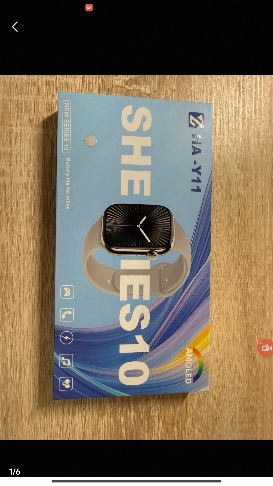

# Case 702: From disagreement to consensus, correctly supporting the buyer's return request

English | [简体中文](README.zh-CN.md)

**Final prediction: Support the buyer; reference outcome: Support the buyer.** The dispute concerns whether the watch received matches the Apple Watch S9 described in the listing. The six jurors initially disagreed about the identity of the product shown in the video. After the seller rejected the after-sales request and the buyer submitted additional comparison images, they gradually reached a unanimous decision to support a return and refund.

**Original human votes: 17 for the buyer, 0 for the seller.** The three rounds of opinions from the six system jurors are listed separately below.

## Case background and key evidence

The product title was “Apple Watch S9 personally used by a male university student, in great condition; mainland China GPS version, Starlight; all original, never disassembled or repaired.” The buyer claimed that the item was “substantially different from the listing” and requested a return and refund. The seller rejected the request on the grounds that “the problem does not exist,” with the explanation field recorded as “None.” The buyer subsequently pointed out differences between the listing and the packaging, model, color, and crown of the watch received.

| Stage | New material in this round | Issue under discussion |
| --- | --- | --- |
| First round | The buyer's two after-sales requests and unboxing video, alleging that “the item sold is counterfeit” and “the item received does not match the description.” | Do the packaging and appearance shown in the video establish a mismatch with the Apple Watch description? |
| Second round | The seller rejects the after-sales request, stating that “the problem does not exist” without a specific explanation. | Does the seller's denial explain the previously raised differences in model and brand? |
| Third round | The buyer adds images of the listing, packaging, actual item, and conversation records, and identifies differences in model, color, and other details. | Does comparing the listing's promises with the received item support a return and refund? |

The image below shows the packaging photograph submitted by the buyer in the third round:

**Figure 1 | Packaging received.** The packaging reads “HA-Y11” and “NEW SERIES 10,” which differ from the S9 description in the listing.

The first-round judgments about packaging and appearance came from the video available at that time; Figure 1 was submitted only in the third round.

## Social relationships and changes in stance

Each juror follows two other jurors throughout the discussion. Arrows in the figure represent the flow of historical opinions: B → A means that A follows B and can read B's opinions from earlier rounds. The three entries inside each node indicate the supported party in the first, second, and third rounds, respectively.

[English figure](images/social_network.en.png)

The numbers supporting the buyer and seller progress as **4∶2 → 5∶1 → 6∶0**. Agent_0, Agent_1, Agent_2, and Agent_4 support the buyer throughout. The two changes in stance occur when Agent_3 switches in the second round and Agent_5 switches in the third.

**Agent_3's change in stance:** It follows Agent_2 and Agent_0, both of whom support the buyer in the first round and emphasize differences between the actual item and the Apple Watch description. By the second round, Agent_3 can read these opinions and changes its assessment from “the video shows features of a genuine product” to “the actual item fundamentally contradicts the listing's promises.”

**Agent_5's change in stance:** It follows Agent_1 and Agent_3. In the first round, these two jurors support the buyer and seller, respectively, and Agent_5 continues to support the seller in the second round. By the second round, both neighbors have either switched to or continued supporting the buyer. In the third round, Agent_5 can read these historical opinions and also sees the newly submitted comparison images, after which it switches to supporting the buyer. Its final reason focuses on the conflict between the packaging and generic instruction manual and the Series 9 description.

Following a juror does not necessarily mean voting with that juror. For example, Agent_4 follows Agent_5 and Agent_3, both of whom support the seller in the first round. After reading these historical opinions, Agent_4 nevertheless continues to support the buyer in the second round and emphasizes that the seller has not explained the model discrepancy.

## GNN explanation: How the correct verdict supporting the buyer is formed

Spatial and temporal masks jointly explain the model's buyer-supporting verdict. The key findings and corresponding messages are presented separately below. Mask weights indicate how strongly messages are retained in the explanation.

### Spatial perspective: Information aggregation within each stage

Spatial messages with high mask weights connect buyer-supporting opinions about discrepancies between the description and the actual item with the corresponding issues in the case.

The table lists key spatial connections identified by GNNExplainer. Arrows show information flow in the model; mask values indicate how much each message is retained in the explanation.

| Spatial message | Mask value | Source opinion or case summary |
| --- | --- | --- |
| Round 1: Agent_1 → Agent_2 | 0.9981 | [Supports the buyer](#opinion-1-1): “the item differs substantially from the seller's description of it as 'genuine'” |
| Round 2: Agent_1 → Agent_0 | 0.9982 | [Supports the buyer](#opinion-2-1): “a clear case of advertising item A but shipping item B and a substantial mismatch with the listing” |
| Round 3: Agent_5 → Agent_4 | 0.9982 | [Supports the buyer](#opinion-3-5): “constitutes a fundamental discrepancy” |

A mismatch between the description and the actual item is the key verdict rationale repeatedly retained by these spatial connections, providing consistent reasons to support the buyer.

### Temporal perspective: Information transmission across stages

Temporal messages correspond to Agent_3 and Agent_5 switching from supporting the seller to supporting the buyer, and to the continuing discussion of product identity across all three rounds.

| Temporal message | Mask value (layer/head) | Corresponding opinion or issue |
| --- | --- | --- |
| Agent_3: Round 1 → 2 | 0.9981 (L1/H1) | [Supports the seller](#opinion-1-3) → [Supports the buyer](#opinion-2-3): “the visual evidence provided instead confirms features of a genuine product” → “the visual evidence provided fundamentally contradicts the written description” |
| Agent_5: Round 2 → 3 | 0.9982 (L1/H0) | [Supports the seller](#opinion-2-5) → [Supports the buyer](#opinion-3-5): “lacks substantive evidence” → “constitutes a fundamental discrepancy” |
| Agent_1: Round 1 → 3 | 0.9990 (L1/H1) | [Supports the buyer](#opinion-1-1) → [Supports the buyer](#opinion-3-1): “the item differs substantially from the seller's description of it as 'genuine'” → “consistency between the description and the actual item is the core criterion” |

**The key explanatory role of these temporal connections is to show how juror opinions converge on supporting the buyer across rounds.**

## Each juror's verdict and reason in every round

<table id="juror-opinions" style="display: table; table-layout: fixed; width: 100%; min-width: 1100px; border-collapse: collapse;">
<colgroup><col style="width: 76px;"><col span="6"></colgroup>
<thead><tr>
<th scope="col" valign="top" style="vertical-align: top; text-align: left; padding: 10px; overflow-wrap: anywhere; line-height: 1.55;">Round</th>
<th scope="col" valign="top" style="vertical-align: top; text-align: left; padding: 10px; overflow-wrap: anywhere; line-height: 1.55;">Agent_0</th>
<th scope="col" valign="top" style="vertical-align: top; text-align: left; padding: 10px; overflow-wrap: anywhere; line-height: 1.55;">Agent_1</th>
<th scope="col" valign="top" style="vertical-align: top; text-align: left; padding: 10px; overflow-wrap: anywhere; line-height: 1.55;">Agent_2</th>
<th scope="col" valign="top" style="vertical-align: top; text-align: left; padding: 10px; overflow-wrap: anywhere; line-height: 1.55;">Agent_3</th>
<th scope="col" valign="top" style="vertical-align: top; text-align: left; padding: 10px; overflow-wrap: anywhere; line-height: 1.55;">Agent_4</th>
<th scope="col" valign="top" style="vertical-align: top; text-align: left; padding: 10px; overflow-wrap: anywhere; line-height: 1.55;">Agent_5</th>
</tr></thead>
<tbody>
<tr data-stage="1" valign="top">
<th scope="row" valign="top" style="vertical-align: top; text-align: left; padding: 10px; overflow-wrap: anywhere; line-height: 1.55; white-space: nowrap;">Round 1</th>
<td data-agent="0" id="opinion-1-0" valign="top" style="vertical-align: top; text-align: left; padding: 10px; overflow-wrap: anywhere; line-height: 1.55;"><!-- opinion:start stage=1 agent=0 -->Verdict: Support the buyer Reason: Under the rules, a buyer with conclusive evidence may return an item if it substantially differs from its description or if the seller advertises item A but ships item B. The current video evidence shows that the seller shipped a third-party imitation labeled “smartwatch,” rather than the genuine Apple Watch described. This is a clear mismatch with the listing and deliberate concealment of the facts, seriously violating transactional integrity. Since the seller cannot provide evidence that a genuine product was shipped, and the visual evidence establishes a substantial discrepancy between the item's condition and its advertising, the buyer's refund request should be supported.<!-- opinion:end stage=1 agent=0 --></td>
<td data-agent="1" id="opinion-1-1" valign="top" style="vertical-align: top; text-align: left; padding: 10px; overflow-wrap: anywhere; line-height: 1.55;"><!-- opinion:start stage=1 agent=1 -->Verdict: Support the buyer Reason: Under the platform rules, a buyer with conclusive evidence may return an item if the seller advertises item A but ships item B or deliberately conceals the facts. The key video evidence in this round shows that the packaging, instruction manual, and appearance of the actual item clearly resemble an imitation Apple Watch rather than a genuine product. This visual evidence directly establishes that the item differs substantially from the seller's description of it as 'genuine'. This is not an ordinary defect in a secondhand item and meets the return conditions for an item that does not match its listing.<!-- opinion:end stage=1 agent=1 --></td>
<td data-agent="2" id="opinion-1-2" valign="top" style="vertical-align: top; text-align: left; padding: 10px; overflow-wrap: anywhere; line-height: 1.55;"><!-- opinion:start stage=1 agent=2 -->Verdict: Support the buyer Reason: Under the platform rules, a buyer may return an item if it substantially differs from the description or is misleadingly described, such as advertising item A but shipping item B. The evidence shows that the seller promised an “Apple Watch,” but the actual item is an imitation bearing the brand “SHEIES10” and model “HA-Y11,” with packaging deliberately imitating the genuine design. This is a clear mismatch with the listing and potential fraud. Although the seller disclosed that it was an imitation, the item's core attributes—brand, model, and value—substantially differ from the description. This falls outside ordinary secondhand defects and meets the conditions for a return and refund.<!-- opinion:end stage=1 agent=2 --></td>
<td data-agent="3" id="opinion-1-3" valign="top" style="vertical-align: top; text-align: left; padding: 10px; overflow-wrap: anywhere; line-height: 1.55;"><!-- opinion:start stage=1 agent=3 -->Verdict: Support the seller  Reason: Under the platform rules, the item's specifications and unboxing video show an Apple Watch and its original accessories. The instruction manual's text and illustrations are consistent, meeting the principle that the item matches the seller's description. The buyer alleges that a counterfeit item was sold, but the visual evidence provided instead confirms features of a genuine product, indicating a mismatch with the buyer's subjective expectations. Since the seller fulfilled the disclosure obligation without concealment, and this is not a major quality issue, the buyer's refund request on the grounds of a mismatch with the description should be rejected under the rules.<!-- opinion:end stage=1 agent=3 --></td>
<td data-agent="4" id="opinion-1-4" valign="top" style="vertical-align: top; text-align: left; padding: 10px; overflow-wrap: anywhere; line-height: 1.55;"><!-- opinion:start stage=1 agent=4 -->Verdict: Support the buyer Reason: The buyer alleges that a counterfeit item was sold and provides an unboxing video as evidence. The evidence shows model HA-Y11, with both the manual and packaging labeled “smartwatch” and no official Apple markings. Under the rules, secondhand listings must be truthful and must not deliberately conceal facts. If the seller did not explicitly disclose that the item was not genuine and merely described it as an ordinary smartwatch, but actually shipped a third-party brand (HA-Y11) as an Apple Watch, this constitutes a substantial mismatch with the listing and description. The buyer's evidence is conclusive, and the seller has not demonstrated fulfillment of the obligation to disclose truthfully. The buyer's refund request should therefore be supported.<!-- opinion:end stage=1 agent=4 --></td>
<td data-agent="5" id="opinion-1-5" valign="top" style="vertical-align: top; text-align: left; padding: 10px; overflow-wrap: anywhere; line-height: 1.55;"><!-- opinion:start stage=1 agent=5 -->Verdict: Support the seller Reason: The current evidence only shows “IES10” and model “HA-Y11” printed on the packaging. This is consistent with the common practice of selling secondhand goods by model and does not prove that the item is counterfeit. Under the rules, without evidence that the seller advertised item A but shipped item B, deliberately concealed facts, or supplied an item with major quality issues, declaring a mismatch solely because the model markings are not those of a genuine branded product reflects the buyer's failure to examine the product's attributes carefully. The available video shows neither abnormal functionality nor counterfeit core components and is insufficient to overturn the fact that the seller fulfilled the obligation to describe the item. The buyer's claim therefore lacks conclusive supporting evidence.<!-- opinion:end stage=1 agent=5 --></td>
</tr>
<tr data-stage="2" valign="top">
<th scope="row" valign="top" style="vertical-align: top; text-align: left; padding: 10px; overflow-wrap: anywhere; line-height: 1.55; white-space: nowrap;">Round 2</th>
<td data-agent="0" id="opinion-2-0" valign="top" style="vertical-align: top; text-align: left; padding: 10px; overflow-wrap: anywhere; line-height: 1.55;"><!-- opinion:start stage=2 agent=0 -->Verdict: Support the buyer Reason: Under the rules, a return should be supported when an item substantially differs from its description. The earlier video provides conclusive evidence that the item is a “SHEIES10” imitation, whose core attributes—brand and model—completely differ from the promised “Apple Watch.” This is a clear case of advertising item A but shipping item B and an item that does not match its listing. The seller's current reason for rejection is that “the problem does not exist,” without any counterevidence, such as proof that a genuine product was shipped or chat records showing that the buyer accepted an imitation. Since the visual evidence conclusively establishes a fundamental conflict between the item and its description, beyond ordinary secondhand defects, the seller's defense is invalid, and the verdict favors the buyer's refund request.<!-- opinion:end stage=2 agent=0 --></td>
<td data-agent="1" id="opinion-2-1" valign="top" style="vertical-align: top; text-align: left; padding: 10px; overflow-wrap: anywhere; line-height: 1.55;"><!-- opinion:start stage=2 agent=1 -->Verdict: Support the buyer Reason: Under the rules, chat records and the product description are central to the decision. Earlier evidence established that the seller described a “genuine Apple Watch,” but the delivery video and packaging show “HA-Y11” and a generic smartwatch, constituting a clear case of advertising item A but shipping item B and a substantial mismatch with the listing. This amounts to deliberate concealment by the seller rather than an ordinary secondhand defect. Although the seller refuses to refund, the existing evidence chain—description versus actual item—directly substantiates the buyer's claim and meets the conditions for a return and refund.<!-- opinion:end stage=2 agent=1 --></td>
<td data-agent="2" id="opinion-2-2" valign="top" style="vertical-align: top; text-align: left; padding: 10px; overflow-wrap: anywhere; line-height: 1.55;"><!-- opinion:start stage=2 agent=2 -->Verdict: Support the buyer Reason: Under the rules, a buyer may return an item when it substantially differs from the description or when the seller advertises item A but ships item B and deliberately conceals the facts. Earlier evidence established that the actual item is an imitation (HA-Y11), whose core attributes substantially differ from the promised “Apple Watch,” beyond ordinary secondhand defects. In this round, the seller rejects the request without providing any counterevidence, such as pre-shipment communications establishing disclosure that the item was not genuine, and cannot explain the fundamental conflict between the description and the actual item. Given the physical differences shown by the multimodal evidence, the seller's defense lacks support. The seller is judged not to have fulfilled the obligation to disclose truthfully, and the buyer's refund request should be supported.<!-- opinion:end stage=2 agent=2 --></td>
<td data-agent="3" id="opinion-2-3" valign="top" style="vertical-align: top; text-align: left; padding: 10px; overflow-wrap: anywhere; line-height: 1.55;"><!-- opinion:start stage=2 agent=3 -->Verdict: Support the buyer Reason: The platform rules explicitly identify chat records and the product description as the primary basis for assessing an item's condition. Historical evidence shows that the seller promised an “Apple Watch,” but the actual item is a “SHEIES10” imitation with deliberately imitative packaging and substantially different core attributes—brand and model. This constitutes a clear case of advertising item A but shipping item B and misleading the buyer. Although the seller claims to have disclosed this, the visual evidence provided fundamentally contradicts the written description, and there was no prior written confirmation from the buyer. Given the substantial differences between the item and its description in the multimodal evidence, and the risk of brand-related fraud, this is beyond ordinary secondhand defects. The seller should be found in breach, and the buyer's return and refund request should be supported.<!-- opinion:end stage=2 agent=3 --></td>
<td data-agent="4" id="opinion-2-4" valign="top" style="vertical-align: top; text-align: left; padding: 10px; overflow-wrap: anywhere; line-height: 1.55;"><!-- opinion:start stage=2 agent=4 -->Verdict: Support the buyer Reason: The seller refuses a refund without providing any counterevidence. Taken together with the earlier evidence, the item's model “HA-Y11” does not match official Apple Watch models, and the item has no markings identifying it as genuine. Under the rules, chat records and visual evidence are key to the decision. If the seller cannot establish authenticity through an inspection report or official documentation and relies only on the defense that the item was sold by model, this amounts to a failure to substantiate the claim. Since the buyer has supplied an unboxing video and objective evidence of the model discrepancy, and the seller cannot reasonably explain why the model and brand do not match, the item should be found not to match its description, and the buyer's return request should be supported.<!-- opinion:end stage=2 agent=4 --></td>
<td data-agent="5" id="opinion-2-5" valign="top" style="vertical-align: top; text-align: left; padding: 10px; overflow-wrap: anywhere; line-height: 1.55;"><!-- opinion:start stage=2 agent=5 -->Verdict: Support the seller Reason: Under the rules, chat records and inspection reports are central to the decision, whereas the current record only shows the seller rejecting the after-sales request and lacks substantive evidence. The earlier video evidence shows consistency between the instruction manual's text and illustrations and features of a genuine product. The buyer's allegation that the seller advertised item A but shipped item B lacks visual substantiation. Without conclusive counterevidence establishing deliberate concealment or a mismatch with the listing, a return request based only on the buyer's subjective expectations does not meet the statutory return condition of a substantial mismatch with the description. The buyer's claim should therefore be rejected.<!-- opinion:end stage=2 agent=5 --></td>
</tr>
<tr data-stage="3" valign="top">
<th scope="row" valign="top" style="vertical-align: top; text-align: left; padding: 10px; overflow-wrap: anywhere; line-height: 1.55; white-space: nowrap;">Round 3</th>
<td data-agent="0" id="opinion-3-0" valign="top" style="vertical-align: top; text-align: left; padding: 10px; overflow-wrap: anywhere; line-height: 1.55;"><!-- opinion:start stage=3 agent=0 -->Verdict: Support the buyer Reason: Strictly applying the platform rules, a substantial discrepancy between the item's core attributes—brand, model, and appearance—and its description constitutes a mismatch with the listing. In this case, the chat records and product page explicitly promise an “Apple Watch S9,” whereas the buyer's physical evidence shows packaging branded “SHEIES10,” model “HA-Y11,” with key features such as the screen and crown markedly different from those of a genuine product. These facts conclusively establish that the seller advertised item A but shipped item B and deliberately concealed the facts, seriously violating transactional integrity. Given the fundamental conflict between the description and the actual item, beyond ordinary secondhand defects, and the seller's failure to provide effective counterevidence, the seller should bear full responsibility under the rules, and the buyer's return and refund request should be supported.<!-- opinion:end stage=3 agent=0 --></td>
<td data-agent="1" id="opinion-3-1" valign="top" style="vertical-align: top; text-align: left; padding: 10px; overflow-wrap: anywhere; line-height: 1.55;"><!-- opinion:start stage=3 agent=1 -->Verdict: Support the buyer Reason: Under the rules, consistency between the description and the actual item is the core criterion. The evidence in this round shows that the seller promised an “Apple Watch S9” and displayed official images, but the actual item is an “HA-Y11/SHEIES10” imitation with substantially different packaging, strap color, and brand markings. This is a clear case of advertising item A but shipping item B and an item that does not match its listing. Such conduct constitutes deliberate concealment and goes far beyond ordinary secondhand defects. Since the buyer's evidence is conclusive and the seller cannot prove authenticity, the seller should be found in breach, and the buyer's return and refund request should be supported.<!-- opinion:end stage=3 agent=1 --></td>
<td data-agent="2" id="opinion-3-2" valign="top" style="vertical-align: top; text-align: left; padding: 10px; overflow-wrap: anywhere; line-height: 1.55;"><!-- opinion:start stage=3 agent=2 -->Verdict: Support the buyer Reason: Under the platform rules, a buyer with conclusive evidence may return an item when it substantially differs from its description or when the seller advertises item A but ships item B without truthful disclosure. In this case, the seller's product page explicitly states “Apple Watch Series 9,” but the actual item is a “SHEIES10/HA-Y11” imitation whose packaging, screen, and appearance fundamentally differ from the description, constituting a clear mismatch with the listing. The seller cannot provide proof of authenticity or explain the discrepancies and refuses to communicate, amounting to deliberate concealment. Together with the multimodal visual evidence, this substantiates the buyer's claim. The seller should be found in breach, and a refund should be supported.<!-- opinion:end stage=3 agent=2 --></td>
<td data-agent="3" id="opinion-3-3" valign="top" style="vertical-align: top; text-align: left; padding: 10px; overflow-wrap: anywhere; line-height: 1.55;"><!-- opinion:start stage=3 agent=3 -->Verdict: Support the buyer Reason: Strictly applying the platform rules, an item that substantially differs from its description constitutes a breach. The key evidence in this case shows that the seller's page explicitly states “Apple Watch S9,” while the actual packaging clearly bears the brand “SHEIES10” and model “HA-Y11,” and the enclosed accessories differ in both color and model. This fundamental discrepancy in brand and model is a clear case of advertising item A but shipping item B and an item that does not match its listing, rather than an ordinary secondhand defect or a mismatch with the buyer's expectations. Since the visual evidence conclusively establishes a substantial conflict between the actual item and its description, the seller has not fulfilled the obligation to disclose truthfully. The buyer's request for a return and full refund should be supported.<!-- opinion:end stage=3 agent=3 --></td>
<td data-agent="4" id="opinion-3-4" valign="top" style="vertical-align: top; text-align: left; padding: 10px; overflow-wrap: anywhere; line-height: 1.55;"><!-- opinion:start stage=3 agent=4 -->Verdict: Support the buyer Reason: Under the rules, chat records and the product description are central to the decision. The evidence chain shows that the seller explicitly promised an “Apple Watch Series 9” in the listing and chat, but the actual item received by the buyer is model “HA-Y11,” with an appearance, strap, and system interface that substantially differ from the description. This is a clear case of advertising item A but shipping item B and an item that does not match its listing. The seller refuses a refund and cannot provide proof of authenticity, violating the obligation to disclose truthfully. Since the available visual evidence is sufficient to refute the seller's description, the buyer's claim meets the return and refund rules and should be supported.<!-- opinion:end stage=3 agent=4 --></td>
<td data-agent="5" id="opinion-3-5" valign="top" style="vertical-align: top; text-align: left; padding: 10px; overflow-wrap: anywhere; line-height: 1.55;"><!-- opinion:start stage=3 agent=5 -->Verdict: Support the buyer Reason: Under the rule concerning items that substantially differ from their description, the actual packaging clearly bears “SHEIES10” and “Smartwatch Instruction Manual,” with no Apple markings. This constitutes a fundamental discrepancy from the promised “Apple Watch Series 9” and is a clear case of advertising item A but shipping item B. The available visual evidence conclusively establishes a substantial discrepancy in the item's core attributes—brand and model—beyond ordinary secondhand defects. The seller refuses to communicate and lacks a reasonable explanation, constituting a breach and meeting the conditions for a return and refund.<!-- opinion:end stage=3 agent=5 --></td>
</tr>
</tbody></table>

