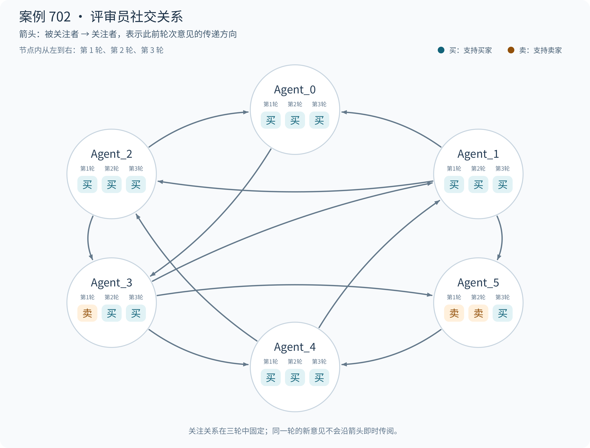

# 案例 702：从分歧到一致，正确支持买家退货

[English](README.md) | 简体中文

**最终预测：支持买家；参考结果：支持买家。** 争议围绕收到的手表是否符合商品页面的 Apple Watch S9 描述展开。六位评审员最初对视频中的商品身份存在分歧，随后在卖家拒绝售后、买家补充对比图片后，逐步形成支持买家退货退款的一致意见。

**原始人工投票：支持买家 17 票，支持卖家 0 票。** 下文六位系统评审员的三轮意见单独列出。

## 案情与关键证据

商品标题为“男大自用靓机苹果手表S9 国行GPS版，星光色，原装无拆无修”。买家认为收到的商品“严重货不对板”，申请退货退款；卖家以“问题不存在”拒绝，拒绝说明为“无”。买家随后指出，收到的包装、型号、颜色及表冠特征与页面描述不同。

| 阶段 | 本轮新增材料 | 本轮争议 |
| --- | --- | --- |
| 第一轮 | 买家两次售后申请及开箱视频：主张“卖的是假货”“收到商品与描述不符”。 | 视频中的包装和外观是否足以证明商品与 Apple Watch 描述不符？ |
| 第二轮 | 卖家拒绝售后，理由为“问题不存在”，没有具体说明。 | 卖家的否认能否解释此前提出的型号和品牌差异？ |
| 第三轮 | 买家补充商品页面、包装、实物及沟通记录图片，并逐项陈述型号、颜色等差异。 | 页面承诺与收到商品的对比，是否支持退货退款？ |

下图为买家在第三轮补充的包装照片：

**图 1｜收到的包装。** 包装可读到“HA-Y11”和“NEW SERIES 10”，与商品页面的 S9 描述存在差异。

第一轮意见中涉及包装和外观的判断来自当时的视频，图 1 在第三轮才补充提交。

## 社交关系与立场变化

每位评审员固定关注另外两位评审员。下图箭头表示历史意见的信息流：B → A 表示 A 关注 B，可以读取 B 在此前轮次的意见。节点中的三项依次表示第一、二、三轮的支持方。

[English figure](images/social_network.en.png)

支持买家与支持卖家的人数依次为 **4∶2 → 5∶1 → 6∶0**。Agent_0、Agent_1、Agent_2、Agent_4 始终支持买家；两次立场变化分别发生在 Agent_3 的第二轮和 Agent_5 的第三轮。

**Agent_3 的转向：** 它关注 Agent_2 和 Agent_0，两人第一轮均支持买家，理由都强调实物与 Apple Watch 描述的差异。到第二轮，Agent_3 已能读取这些意见，并将自己的判断从“视频体现正品特征”改为“实物与页面承诺根本矛盾”。

**Agent_5 的转向：** 它关注 Agent_1 和 Agent_3。第一轮这两位分别支持买家、卖家，Agent_5 在第二轮仍支持卖家；第二轮两位邻居都转为或保持支持买家，到第三轮 Agent_5 可以读取这些历史意见，也看到了新增的对比图片，随后改为支持买家。它的最终理由聚焦包装和通用说明书与 Series 9 描述的冲突。

关注也不意味着跟随邻居投票。例如，Agent_4 关注的 Agent_5 和 Agent_3 在第一轮都支持卖家，但 Agent_4 读取这些历史意见后，第二轮仍支持买家，并继续强调卖家没有解释型号差异。

## GNN 解释：如何形成支持买家的正确裁决

空间与时间掩码共同解释模型的买家裁决，下面分别列出关键结论及对应消息。掩码权重表示解释中保留消息的程度。

### 空间层面：阶段内信息聚合

高掩码空间消息连接了商品描述与实物差异的买方意见，以及对应的案件争点。

下表列出 GNNExplainer 识别的关键空间连接；箭头表示信息传递方向，掩码值表示消息在解释中的保留程度。

| 空间消息 | 掩码值 | 来源意见或案件摘要 |
| --- | --- | --- |
| 第 1 轮：Agent_1 → Agent_2 | 0.9981 | [支持买家](#opinion-1-1)：“商品与卖家描述的“正品”严重不符” |
| 第 2 轮：Agent_1 → Agent_0 | 0.9982 | [支持买家](#opinion-2-1)：“构成典型的“拍 A 发 B"及严重货不对板” |
| 第 3 轮：Agent_5 → Agent_4 | 0.9982 | [支持买家](#opinion-3-5)：“构成根本性差异” |

“描述与实物不符”是这些空间连接反复保留的关键裁决线索，为支持买家提供了一致的理由。

### 时间层面：跨阶段信息传递

时间消息对应 Agent_3、Agent_5 从支持卖家转向买家，以及商品身份争点在三轮中的持续讨论。

| 时间消息 | 掩码值（层／头） | 对应意见或争点 |
| --- | --- | --- |
| Agent_3：第 1 → 2 轮 | 0.9981（L1/H1） | [支持卖家](#opinion-1-3) → [支持买家](#opinion-2-3)：“提供的视觉证据反而证实了正品特征” → “提供的视觉证据与文字描述存在根本性矛盾” |
| Agent_5：第 2 → 3 轮 | 0.9982（L1/H0） | [支持卖家](#opinion-2-5) → [支持买家](#opinion-3-5)：“缺乏实质证据” → “构成根本性差异” |
| Agent_1：第 1 → 3 轮 | 0.9990（L1/H1） | [支持买家](#opinion-1-1) → [支持买家](#opinion-3-1)：“商品与卖家描述的“正品”严重不符” → “商品描述与实物一致是核心判定标准” |

**这些时间连接的关键解释作用，是展示评审意见如何从分歧走向一致支持买家。**

## 每位评审员在每一轮的裁决与理由

<table id="juror-opinions" style="display: table; table-layout: fixed; width: 100%; min-width: 1100px; border-collapse: collapse;">
<colgroup><col style="width: 76px;"><col span="6"></colgroup>
<thead><tr>
<th scope="col" valign="top" style="vertical-align: top; text-align: left; padding: 10px; overflow-wrap: anywhere; line-height: 1.55;">轮次</th>
<th scope="col" valign="top" style="vertical-align: top; text-align: left; padding: 10px; overflow-wrap: anywhere; line-height: 1.55;">Agent_0</th>
<th scope="col" valign="top" style="vertical-align: top; text-align: left; padding: 10px; overflow-wrap: anywhere; line-height: 1.55;">Agent_1</th>
<th scope="col" valign="top" style="vertical-align: top; text-align: left; padding: 10px; overflow-wrap: anywhere; line-height: 1.55;">Agent_2</th>
<th scope="col" valign="top" style="vertical-align: top; text-align: left; padding: 10px; overflow-wrap: anywhere; line-height: 1.55;">Agent_3</th>
<th scope="col" valign="top" style="vertical-align: top; text-align: left; padding: 10px; overflow-wrap: anywhere; line-height: 1.55;">Agent_4</th>
<th scope="col" valign="top" style="vertical-align: top; text-align: left; padding: 10px; overflow-wrap: anywhere; line-height: 1.55;">Agent_5</th>
</tr></thead>
<tbody>
<tr data-stage="1" valign="top">
<th scope="row" valign="top" style="vertical-align: top; text-align: left; padding: 10px; overflow-wrap: anywhere; line-height: 1.55; white-space: nowrap;">第 1 轮</th>
<td data-agent="0" id="opinion-1-0" valign="top" style="vertical-align: top; text-align: left; padding: 10px; overflow-wrap: anywhere; line-height: 1.55;"><!-- opinion:start stage=1 agent=0 -->结论：支持买家 理由：依据规则，若商品严重不符描述或存在“拍 A 发 B"，买家证据确凿可退货。当前视频证据显示，卖家发货为标注“智能手表”的第三方仿款，绝非描述中的正品 Apple Watch。此行为构成典型的“货不对板”及刻意隐瞒实情，严重违背交易诚信。在卖家无法提供正品发货证据的情况下，基于视觉证据认定的商品状态与宣传严重背离，应支持买家退款诉求。<!-- opinion:end stage=1 agent=0 --></td>
<td data-agent="1" id="opinion-1-1" valign="top" style="vertical-align: top; text-align: left; padding: 10px; overflow-wrap: anywhere; line-height: 1.55;"><!-- opinion:start stage=1 agent=1 -->结论：支持买家 理由：依据平台规则，卖家若存在“拍 A 发 B"或刻意隐瞒实情，买家证据确凿即可退货。本轮关键视频证据显示，实物包装、说明书及外观特征均呈现明显的仿 Apple Watch 特征，而非正品。此视觉证据直接证明了商品与卖家描述的“正品”严重不符，且非正常二手瑕疵，符合“货不对板”的退货条件。<!-- opinion:end stage=1 agent=1 --></td>
<td data-agent="2" id="opinion-1-2" valign="top" style="vertical-align: top; text-align: left; padding: 10px; overflow-wrap: anywhere; line-height: 1.55;"><!-- opinion:start stage=1 agent=2 -->结论：支持买家 理由：根据平台规则，若商品严重不符或存在误导性描述（如拍 A 发 B），买家可退。证据显示卖家承诺"Apple Watch"，但实物为"SHEIES10"品牌、型号"HA-Y11"的仿款，包装盒刻意模仿正品设计。此行为构成典型的“货不对板”及潜在欺诈，卖家虽告知了仿品事实，但商品核心属性（品牌、型号、价值）与描述严重背离，非正常二手瑕疵范畴，符合退货退款条件。<!-- opinion:end stage=1 agent=2 --></td>
<td data-agent="3" id="opinion-1-3" valign="top" style="vertical-align: top; text-align: left; padding: 10px; overflow-wrap: anywhere; line-height: 1.55;"><!-- opinion:start stage=1 agent=3 -->结论：支持卖家  理由：根据平台规则，实物参数及开箱视频显示商品为 Apple Watch 及其原装配件，说明书图文一致，符合“商品符合卖家描述”原则。买家主张“卖假货”但提供的视觉证据反而证实了正品特征，属于主观预期偏差。鉴于卖家已履行告知义务且无隐瞒，非重大质量问题，依据规则应驳回买家因描述不符发起的退款申请。<!-- opinion:end stage=1 agent=3 --></td>
<td data-agent="4" id="opinion-1-4" valign="top" style="vertical-align: top; text-align: left; padding: 10px; overflow-wrap: anywhere; line-height: 1.55;"><!-- opinion:start stage=1 agent=4 -->结论：支持买家 理由：买家主张“卖假货”并提供开箱视频为证。证据显示商品型号为 HA-Y11，说明书及包装均标注“智能手表”，无 Apple 官方标识。根据规则，二手商品描述需真实且不得刻意隐瞒。若卖家未明确告知非正品，仅以普通智能手表描述，实则发第三方品牌（HA-Y11）冒充 Apple Watch，属于严重的“货不对板”及描述不符。买家证据确凿，卖家未能证明已履行如实告知义务，故支持买家退款诉求。<!-- opinion:end stage=1 agent=4 --></td>
<td data-agent="5" id="opinion-1-5" valign="top" style="vertical-align: top; text-align: left; padding: 10px; overflow-wrap: anywhere; line-height: 1.55;"><!-- opinion:start stage=1 agent=5 -->结论：支持卖家 理由：当前证据仅显示商品包装印有"IES10"及"HA-Y11"型号，这符合二手交易中“按型号销售”的常见特征，而非证明其为假货。依据规则，若无证据证明卖家存在“拍 A 发 B"、刻意隐瞒或商品严重质量问题，仅因型号标识非品牌正品即认定为“货不对板”，属于买家未仔细甄别商品属性。现有视频未展示商品功能异常或核心部件造假，不足以推翻卖家已履行描述义务的事实，故买家诉求缺乏确凿证据支撑。<!-- opinion:end stage=1 agent=5 --></td>
</tr>
<tr data-stage="2" valign="top">
<th scope="row" valign="top" style="vertical-align: top; text-align: left; padding: 10px; overflow-wrap: anywhere; line-height: 1.55; white-space: nowrap;">第 2 轮</th>
<td data-agent="0" id="opinion-2-0" valign="top" style="vertical-align: top; text-align: left; padding: 10px; overflow-wrap: anywhere; line-height: 1.55;"><!-- opinion:start stage=2 agent=0 -->结论：支持买家 理由：依据规则，商品严重不符描述即支持退货。前序视频铁证显示实物为"SHEIES10"仿款，与卖家承诺的"Apple Watch"核心属性（品牌、型号）完全背离，属典型的“拍 A 发 B"及货不对板。卖家本次拒绝理由为“问题不存在”，未提供任何反证（如正品发货凭证或买家认可仿品的聊天记录）。鉴于视觉证据已确凿证明商品本质与描述冲突，且非正常二手瑕疵范畴，卖家抗辩无效，裁决倾向支持买家退款。<!-- opinion:end stage=2 agent=0 --></td>
<td data-agent="1" id="opinion-2-1" valign="top" style="vertical-align: top; text-align: left; padding: 10px; overflow-wrap: anywhere; line-height: 1.55;"><!-- opinion:start stage=2 agent=1 -->结论：支持买家 理由：依据规则，聊天记录与商品描述是判定核心。前序证据已证实卖家描述“正品 Apple Watch"，但实物签收视频及包装显示为"HA-Y11"及通用智能手表，构成典型的“拍 A 发 B"及严重货不对板。这属于卖家刻意隐瞒实情，非正常二手瑕疵。尽管卖家拒付，但现有证据链（描述 vs 实物）直接证明买家主张成立，符合退货退款条件。<!-- opinion:end stage=2 agent=1 --></td>
<td data-agent="2" id="opinion-2-2" valign="top" style="vertical-align: top; text-align: left; padding: 10px; overflow-wrap: anywhere; line-height: 1.55;"><!-- opinion:start stage=2 agent=2 -->结论：支持买家 理由：依据规则，商品严重不符或存在“拍 A 发 B"且卖家刻意隐瞒时，买家可退货。前序证据已证实实物为仿款（HA-Y11），与卖家承诺的"Apple Watch"核心属性严重背离，非正常二手瑕疵。卖家本轮拒绝申请却未提供任何反证（如发货前沟通记录证明已告知非正品），且无法解释为何商品描述与实物存在根本性冲突。结合多模态证据显示的实体差异，卖家抗辩缺乏支撑，判定卖家未尽如实告知义务，支持买家退款。<!-- opinion:end stage=2 agent=2 --></td>
<td data-agent="3" id="opinion-2-3" valign="top" style="vertical-align: top; text-align: left; padding: 10px; overflow-wrap: anywhere; line-height: 1.55;"><!-- opinion:start stage=2 agent=3 -->结论：支持买家 理由：平台规则明确，聊天记录及商品描述是判断商品状态的核心依据。历史证据显示卖家承诺"Apple Watch"，但实物为"SHEIES10"仿款，包装盒刻意模仿，核心属性（品牌、型号）严重背离，构成典型的“拍 A 发 B"及误导。虽然卖家声称已告知，但提供的视觉证据与文字描述存在根本性矛盾，且未经过买家事前书面确认。基于多模态证据中实物与描述的巨大差异，且涉及品牌欺诈风险，非正常二手瑕疵范畴，应判定卖家违约，支持买家退货退款。<!-- opinion:end stage=2 agent=3 --></td>
<td data-agent="4" id="opinion-2-4" valign="top" style="vertical-align: top; text-align: left; padding: 10px; overflow-wrap: anywhere; line-height: 1.55;"><!-- opinion:start stage=2 agent=4 -->结论：支持买家 理由：卖家拒绝退款却未提供任何反证。结合前序证据，商品型号"HA-Y11"与 Apple Watch 官方型号不符，且无正品标识。依据规则，聊天记录和视觉证据是判断关键。若卖家未能通过质检报告或官方凭证证明商品为正品，仅以“型号销售”抗辩，属于举证不能。鉴于买家已提供开箱视频及型号差异的客观证据，且卖家无法合理解释型号与品牌不符的原因，应认定存在描述不符，支持买家退货诉求。<!-- opinion:end stage=2 agent=4 --></td>
<td data-agent="5" id="opinion-2-5" valign="top" style="vertical-align: top; text-align: left; padding: 10px; overflow-wrap: anywhere; line-height: 1.55;"><!-- opinion:start stage=2 agent=5 -->结论：支持卖家 理由：依据规则，聊天记录与质检报告为判断核心，而当前仅显示卖家拒绝售后，缺乏实质证据。此前视频证据显示说明书图文一致且具正品特征，买家主张“拍 A 发 B"缺乏视觉实证。在无确凿反证证明卖家刻意隐瞒或货不对板的情况下，买家仅凭主观预期偏差申请退货，不符合“严重不符合描述”的法定退货条件，故驳回买家诉求。<!-- opinion:end stage=2 agent=5 --></td>
</tr>
<tr data-stage="3" valign="top">
<th scope="row" valign="top" style="vertical-align: top; text-align: left; padding: 10px; overflow-wrap: anywhere; line-height: 1.55; white-space: nowrap;">第 3 轮</th>
<td data-agent="0" id="opinion-3-0" valign="top" style="vertical-align: top; text-align: left; padding: 10px; overflow-wrap: anywhere; line-height: 1.55;"><!-- opinion:start stage=3 agent=0 -->结论：支持买家 理由：严格对照平台规则，商品核心属性（品牌、型号、外观）严重不符描述即构成“货不对板”。本案例中，聊天记录及商品详情页明确承诺出售"Apple Watch S9"，而买家提交的实物证据显示包装盒品牌为"SHEIES10"、型号"HA-Y11"，且屏幕、表冠等关键特征与正品迥异。此事实确凿证明卖家存在典型的“拍 A 发 B"及刻意隐瞒实情行为，已严重违背交易诚信。鉴于描述与实物存在根本性冲突，非正常二手瑕疵范畴，且卖家未能提供有效反证，依据规则应判定卖家全责，支持买家退货退款诉求。<!-- opinion:end stage=3 agent=0 --></td>
<td data-agent="1" id="opinion-3-1" valign="top" style="vertical-align: top; text-align: left; padding: 10px; overflow-wrap: anywhere; line-height: 1.55;"><!-- opinion:start stage=3 agent=1 -->结论：支持买家 理由：依据规则，商品描述与实物一致是核心判定标准。本轮证据显示，卖家承诺销售"Apple Watch S9"并展示官方图，但实物为"HA-Y11/SHEIES10"仿品，包装、表带颜色及品牌标识均严重不符，构成典型“拍 A 发 B"及货不对板。此行为属于刻意隐瞒实情，远超正常二手瑕疵范畴。鉴于买家证据确凿且卖家无法提供正品证明，判定卖家违约，支持买家退货退款。<!-- opinion:end stage=3 agent=1 --></td>
<td data-agent="2" id="opinion-3-2" valign="top" style="vertical-align: top; text-align: left; padding: 10px; overflow-wrap: anywhere; line-height: 1.55;"><!-- opinion:start stage=3 agent=2 -->结论：支持买家 理由：依据平台规则，商品严重不符或“拍 A 发 B"且卖家未如实告知，买家证据确凿即可退货。本案例中，卖家详情页明确标注"Apple Watch Series 9"，但实物为"SHEIES10/HA-Y11"仿款，包装盒、屏幕及外观均与描述存在根本性差异，构成典型的“货不对板”。卖家未能提供正品凭证或解释差异原因，且拒绝沟通，属于刻意隐瞒实情。结合多模态视觉证据，买家主张成立，判定卖家违约，支持退款。<!-- opinion:end stage=3 agent=2 --></td>
<td data-agent="3" id="opinion-3-3" valign="top" style="vertical-align: top; text-align: left; padding: 10px; overflow-wrap: anywhere; line-height: 1.55;"><!-- opinion:start stage=3 agent=3 -->结论：支持买家 理由：严格对照平台规则，商品严重不符描述即构成违约。本案关键证据显示，卖家页面明确标注"Apple Watch S9"，而实物包装盒清晰印有"SHEIES10"品牌及"HA-Y11"型号，且内部配件颜色型号均不一致。这种品牌与型号的根本性背离，属于典型的“拍 A 发 B"及货不对板，绝非正常二手瑕疵或买家预期偏差。鉴于视觉证据确凿证明实物与描述严重冲突，卖家未尽如实告知义务，应全额支持买家退货退款诉求。<!-- opinion:end stage=3 agent=3 --></td>
<td data-agent="4" id="opinion-3-4" valign="top" style="vertical-align: top; text-align: left; padding: 10px; overflow-wrap: anywhere; line-height: 1.55;"><!-- opinion:start stage=3 agent=4 -->结论：支持买家 理由：依据规则，聊天记录与商品描述是判定核心。证据链显示，卖家在详情页及聊天中明确承诺商品为"Apple Watch Series 9"，但买家收到的实物型号为"HA-Y11"，外观、表带及系统界面均与描述严重不符，构成典型的“拍 A 发 B"及货不对板。卖家拒绝退款且无法提供正品证明，其行为违背了如实告知义务。鉴于现有视觉证据足以推翻卖家描述，买家诉求符合退货退款规则，应支持买家。<!-- opinion:end stage=3 agent=4 --></td>
<td data-agent="5" id="opinion-3-5" valign="top" style="vertical-align: top; text-align: left; padding: 10px; overflow-wrap: anywhere; line-height: 1.55;"><!-- opinion:start stage=3 agent=5 -->结论：支持买家 理由：依据“商品严重不符合描述”规则，实物包装明确印有"SHEIES10"及“智能手表说明书”，且无 Apple 标识，与卖家承诺的"Apple Watch Series 9"构成根本性差异，属典型的“拍 A 发 B"。现有视觉证据确凿证明商品核心属性（品牌、型号）严重背离，非正常二手瑕疵。卖家拒绝沟通且缺乏合理解释，已构成违约，符合退货退款条件。<!-- opinion:end stage=3 agent=5 --></td>
</tr>
</tbody></table>

